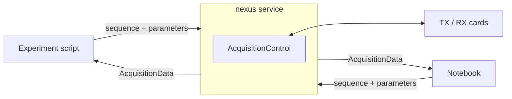

# Acquisition service

The `nexus` command starts a persistent acquisition service. It connects to the measurement cards once and keeps the connection open, while experiment scripts and notebooks connect to the service as clients to run acquisitions.

## Motivation

In the [first acquisition](first-acquisition.md), the experiment script creates `AcquisitionControl` itself, so the cards are connected and disconnected with every script run or kernel restart. Running the cards in a separate service has several advantages:

- **Safety and convenience:** the XIO outputs are pulled high while the cards are opened, so the amplifiers must be switched off whenever the cards are connected (see [Wiring](../system/wiring.md#safety)). With the service, this happens only once per session.
- **Robustness:** a crashing script or a restarted notebook kernel does not affect the card connection.
- **Separation:** hardware control runs in its own process, independent of the environment used for sequence design, reconstruction and plotting.
- **Remote access:** experiments can be run from another computer in the network.

## How it works



The service creates a single [`AcquisitionControl`][console.spcm_control.acquisition_control.AcquisitionControl] instance and serves it via [`AcquisitionControlManager`][console.service.acquisition_manager.AcquisitionControlManager], a Python [`multiprocessing` manager](https://docs.python.org/3/library/multiprocessing.html#managers). Clients receive a proxy object which behaves like a local `AcquisitionControl`: method calls such as `set_sequence` and `run` are executed in the service process, their arguments are sent to the service and the resulting `AcquisitionData` is returned to the client.

## Starting the service

Start the service in a separate terminal on the computer with the measurement cards:

```bash
nexus -d path/to/device_config.yaml
```

The service asks for confirmation that all amplifiers are switched off, connects the cards and then waits for clients. Logs and acquisition data are written to the sessions folder, `<home>/nexus-console` by default.

| Option | Description | Default |
|---|---|---|
| `-d`, `--device_config` | Device configuration file (required) | |
| `-f`, `--sessions_folder` | Directory for logs and acquisition data | `<home>/nexus-console` |
| `-a`, `--address` | Address the service binds to | `localhost` |
| `-p`, `--port` | Port of the service | `50000` |
| `-n`, `--no-verify` | Skip the amplifier confirmation prompt | |

Stop the service with <kbd>Ctrl</kbd>+<kbd>C</kbd>, which disconnects the cards.

## Running an acquisition

Clients connect with `AcquisitionControlManager` and access the remote instance as `mngr.acquisition`:

```python
import console
from console.service.acquisition_manager import AcquisitionControlManager
from console.utilities.sequences import se_spectrum

console.parameter.larmor_frequency = 2.0e6

with AcquisitionControlManager() as mngr:
    system = mngr.acquisition.get_sequence_system()
    seq = se_spectrum.constructor(echo_time=20e-3, rf_duration=200e-6, system=system)

    mngr.acquisition.set_sequence(sequence=seq, parameter=console.parameter)
    acq_data = mngr.acquisition.run()

acq_data.save()
```

The client uses the same API as a local `AcquisitionControl`, so existing scripts only need to replace the instantiation. As all clients share one `AcquisitionControl` instance, acquisitions should be run from one client at a time.

To connect from another computer, start the service with `-a 0.0.0.0` (or the IP address of the host) and pass the host address to the client:

```python
with AcquisitionControlManager(address=("192.168.0.10", 50000)) as mngr:
    ...
```

!!! warning
    The connection is only protected by the authentication key of the manager, and the default key is publicly known. Expose the service only in a trusted network.

A complete client example is given in [Remote acquisition](../examples/remote_acquisition.md).
