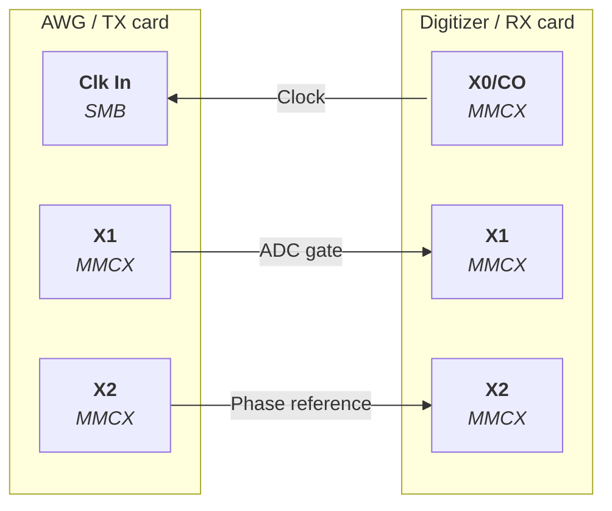

# Hardware setup

This page describes how to set up the console hardware with one arbitrary waveform generator (AWG) module and one digitizer module. The interaction of the console workstation with the other components of the MRI system is explained in the [System overview](../system/overview.md#system-architecture).

!!! note "Supported cards"
    The software was developed with and for measurement cards from Spectrum Instrumentation. Specifically for the arbitrary waveform generator module M2p.6546-x4 and the digitizer module M2p.5933-x4. We expect other modules from the M2p family to work with the framework as well, but we haven't tested this yet.

!!! note "One transmit and one receive card"
    So far, the software is designed for exactly one transmit and one receive card.

!!! note "Synchronization"
    The transmit and receive cards are synchronized by a wired connection between the cards. Synchronization via the Star-Hub module is not supported yet. This is work in progress and will be added later.

## Measurement cards and driver

!!! warning "Disclaimer"
    Installing, wiring and operating the measurement cards and the connected MRI hardware is at your own risk. The developers of this software framework assume no responsibility or liability for any damage to the measurement cards, the computer system hosting the measurement cards or other hardware resulting from installation, wiring or use. Always follow the safety and installation instructions in the official Spectrum Instrumentation manuals [[6]](../references.md#ref-6).

1. Install the cards and the driver as described in the hardware manual of each card, available from the Spectrum Instrumentation [download area](https://spectrum-instrumentation.com/support/downloads.php) (e.g. the [M2p.65xx manual](https://spectrum-instrumentation.com/dl/m2p_65xx_manual_english.pdf) and the [M2p.59xx manual](https://spectrum-instrumentation.com/dl/m2p_59xx_manual_english.pdf)). The relevant chapters are *Safety Instructions*, *Hardware Installation* and *Software Driver Installation and Driver Update*.
2. Install the Spectrum Control Center (section *Control Center* in the driver installation chapter of the manual) and use it to verify that both cards are detected.
3. Note the device paths of both cards (`/dev/spcm0`, `/dev/spcm1`, ...). They are required for the [device configuration](installation.md#device-configuration).

## Connection plan

The connector names below are those printed on the card brackets. Analog channels, clock input and trigger input use SMB connectors, the multi-purpose lines X0–X3 use MMCX connectors, so some connections require adapter cables (e.g. MMCX to SMB). The complete port assignment of both cards, including the unused ports, is listed in [Console hardware](../system/hardware.md#inputs-and-outputs).

### Card synchronization

For the card synchronization shorter adapter cables are required (10-20 cm, depending on the PCIe slot positions). This includes MMCX to SMB for the clock synchronization and two MMCX to MMCX cables.

- **Clock**: The transmit card is configured to run on an external clock which is provided by the receive card, whereby both cards sample synchronously. The sampling rates of both cards in the device configuration must therefore be identical.
- **ADC gate**: The transmit card outputs a digital gate signal on X1 that is high during each ADC event of the sequence. The receive card uses X1 as logic trigger input and records exactly the gated samples.
- **Phase reference**: The transmit card outputs a square wave on X2, which the receive card samples together with the MR signal. It is used to correct the phase of each acquisition (see [Phase reference](../system/signal-flow.md#phase-reference)).

### MRI system

| Card | Port | Port type | Connection to | Signal |
|---|---|---|---|---|
| AWG | 0 | SMB | RFPA input | RF waveforms calculated from the Pulseq sequence |
| AWG | X3 | MMCX | RFPA unblanking | Digital RF unblanking signal (5 V high) |
| AWG | 1–3 | SMB | GPA inputs | Gradient waveforms of the three gradient axes calculated from the Pulseq sequence |
| Digitizer | 0 | SMB | Preamplifier output | Received and preamplified MR signal |

The assignment of the gradient outputs on the console side to the gradient power amplifier and the respective gradient coils is fixed. However, the mapping from the Pulseq gradient channels (x, y, z) to the console outputs can be adjusted using the acquisition parameter `channel_assignment` (default: x → 1, y → 2, z → 3).

With an IO expansion module on the transmit card, the ADC gate and the unblanking signal are additionally available on X12 and X13.

## Hardware configuration

Before starting with the installation of the nexus-console, you should collect all required hardware parameters of your specific setup:

- The device paths of the measurement cards, obtained, for instance, from the *spcmcontrol* software.
- The maximum amplitude per channel (for the AWG and digitizer modules). The maximum output amplitude should be compatible with the maximum input ratings of the amplifiers (RFPA and GPA).
- The load impedance of each AWG output (50 Ω or high impedance).

    !!! note "Output voltage doubles into high-impedance loads"
        The AWG outputs have a 50 Ω series termination and the programmed amplitude refers to a 50 Ω load. If an output drives a high-impedance load instead, the output voltage is double the programmed value. Usually, the RF line (AWG channel 0) is connected to the 50 Ω input of the RFPA, while the gradient lines (AWG channels 1–3) are connected to high-impedance GPA inputs. The console compensates for the doubling based on the [device configuration](../system/configuration.md#configuration-file).

- If you use more than one receive channel, enable the corresponding channels and set the termination per channel.
- The GPA gain in A/V.
- The efficiency of each of your gradient channels in T/m/A. The gradient efficiency and the GPA gain determine whether the sequence is replayed correctly.

Continue with the [Installation](installation.md) of the software.
