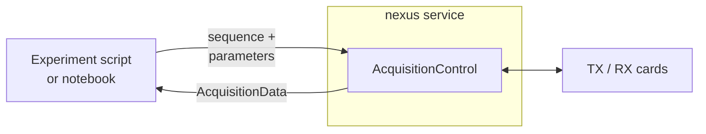

# Acquisition service

The `nexus` command starts a persistent acquisition service. It connects to the measurement cards once and keeps the connection open, while experiment scripts and notebooks connect to the service as clients to run acquisitions.

## Motivation

In the [first acquisition](first-acquisition.md), the experiment script creates `AcquisitionControl` itself, so the cards are connected and disconnected with every script run or kernel restart. Running the cards in a separate service has several advantages:

- **Less overhead:** every connection resets and configures the cards (clock, sampling rate, channels, digital outputs) and starts the processing workers. With the service, this setup is done once per session instead of with every script run.
- **Robustness:** a crashing script or a restarted notebook kernel does not affect the card connection.
- **Separation:** hardware control runs in its own process, independent of the environment used for sequence design, reconstruction and plotting.

## How it works



The service creates a single [`AcquisitionControl`][console.spcm_control.acquisition_control.AcquisitionControl] instance and serves it via `AcquisitionControlManager` (`nexus_service.acquisition_manager`), a Python [`multiprocessing` manager](https://docs.python.org/3/library/multiprocessing.html#managers). Clients receive a proxy object which behaves like a local `AcquisitionControl`: method calls such as `set_sequence` and `run` are executed in the service process, their arguments are sent to the service and the resulting `AcquisitionData` is returned to the client.

Service and clients communicate through a unix domain socket on the workstation. The service is not reachable over the network; to use the console from another computer, log in via SSH and run the client there.

## Starting the service

Start the service in a separate terminal on the computer with the measurement cards:

```bash
nexus -d path/to/device_config.yaml
```

The service asks for confirmation that all amplifiers are switched off, connects the cards and then waits for clients.

| Option | Description | Default |
|---|---|---|
| `-d`, `--device_config` | Device configuration file (required) | |
| `-l`, `--log_dir` | Directory of the log file `<date>_nexus.log` | `~/nexus-console` |
| `-n`, `--no-verify` | Skip the amplifier confirmation prompt | |

Stop the service with <kbd>Ctrl</kbd>+<kbd>C</kbd>, which disconnects the cards.

To start the service automatically at system boot, run it as a systemd unit under a dedicated account instead, see [Service deployment](deployment.md).

## Running an acquisition

Clients resolve the socket and the authentication key from the [runtime directory](#runtime-directory), so the manager is constructed without arguments. The remote instance is accessed as `manager.acquisition`:

```python
import console
from nexus_service.acquisition_manager import AcquisitionControlManager
from console.utilities.sequences import se_spectrum

console.parameter.larmor_frequency = 2.0e6

with AcquisitionControlManager() as manager:
    system = manager.acquisition.get_sequence_system()
    seq = se_spectrum.constructor(echo_time=20e-3, rf_duration=200e-6, system=system)

    manager.acquisition.set_sequence(sequence=seq, parameter=console.parameter)
    acq_data = manager.acquisition.run()

acq_data.save()
```

The client uses the same API as a local `AcquisitionControl`, so existing scripts only need to replace the instantiation.

!!! warning "One client at a time"
    All clients share a single `AcquisitionControl` instance, and the service does not serialize access to it. Each client connection is handled in its own thread, so calls of different clients run concurrently: a `set_sequence` of a second client can replace the sequence of the first one before its `run`, and two simultaneous `run` calls access the cards at the same time. Coordinate the use of the console so that only one client runs acquisitions at a time.

If the service is not running, constructing or entering the manager raises a `NexusNotRunningError`, a `ConnectionError` whose message explains how to start the service.

A complete client example is given in [Remote acquisition](../examples/remote_acquisition.md).

## Acquisition data

The service does not store acquisition data. `manager.acquisition.run()` returns the `AcquisitionData` object to the client, and `save()` and `save_ismrmrd()` run in the client process, i.e. under the account which called them. Without a `user_path`, the data is written to `~/nexus-console/<date>-session` of that account; with `user_path`, the session folder is created in the given directory.

## Runtime directory

Service and clients exchange the connection details through a runtime directory. When the service is started by hand, this is `<tempdir>/nexus` (a systemd unit uses `/run/nexus`, see [Service deployment](deployment.md)). The environment variable `NEXUS_RUNTIME_DIR` overrides the location, e.g. to isolate tests from a running service.

| File | Description |
|---|---|
| `nexus.sock` | Unix domain socket of the service, accessible by every account |
| `authkey` | Authentication key, generated at every service start and readable by every account |

The directory is created with mode `1777`, the same permissions that `/tmp` uses. Every account on the workstation can read the key and connect to the socket, while the sticky bit allows only the owner of a file to delete or rename it, so no account can remove the socket or the key of another. If the directory is a symbolic link or has different permissions, e.g. because another account created it beforehand, the service and the clients refuse to use it.

Note that `/tmp` is periodically cleaned by the system, and that leftovers of another account can only be removed by that account or root.

!!! warning "The authentication key is not a secret"
    The key only ensures that clients connect to the currently running service, not to one from a previous run. It does not protect against other users of the workstation: any client holding the key can make the service execute code on its behalf, and the measurement cards are world-accessible character devices. Run the service under an ordinary operator account, never as root.

Both files are removed when the service shuts down. If the service is killed without being able to clean up, the socket file remains; the next service start detects that nothing is listening behind it and removes it. A second service instance started while the first one is still running aborts with an error instead of interfering with the running acquisition.

!!! note "Windows"
    Windows has neither unix domain sockets nor POSIX permissions. There, the service listens on a named pipe named after the socket path, `\\.\pipe\<runtime directory>/nexus.sock`, which vanishes with the service, and the runtime directory is `<tempdir>\nexus`, which is private to the account. Windows only grants the account which started the service write access to the pipe, so only this account can connect to it.
