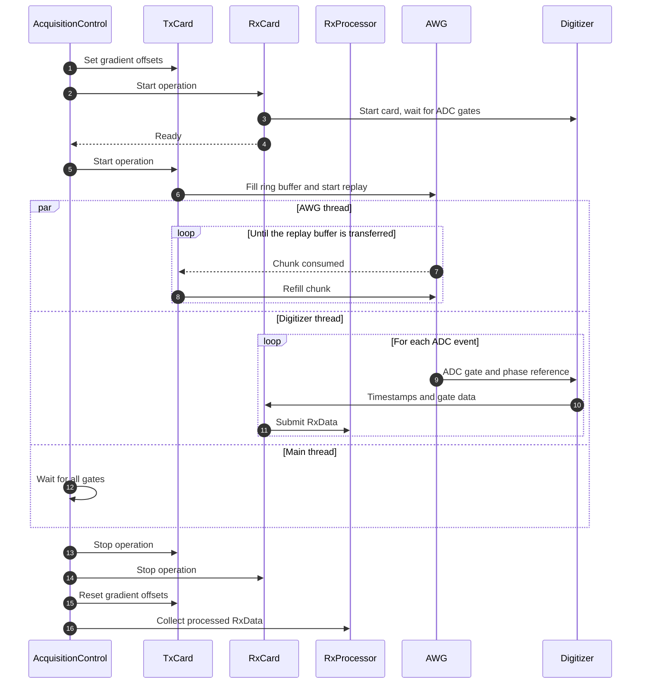

# Acquisition

An acquisition is executed by [`AcquisitionControl.run`][console.spcm_control.acquisition_control.AcquisitionControl.run] after the sequence has been calculated by `set_sequence`. The AWG replays the calculated sequence while the digitizer records one gate per ADC event. Each average is a complete replay of the sequence.

## Sequence of operations

Steps 2–14 are executed once per average; the next average starts after `averaging_delay`. Averages are not summed, each `RxData` carries its `average_index`.

| Steps | Description |
|---|---|
| 1, 15 | The gradient offsets of the acquisition parameters are written to the offset registers of AWG channels 1–3 before the first average and reset to zero after the last. |
| 2–5 | The digitizer is started first and waits for the first ADC gate. As soon as its thread is ready, the AWG is started; it uses a software trigger, so the replay begins immediately. |
| 6–8 | The AWG replays the sequence while the TX thread refills the ring buffer (see [AWG: FIFO streaming](#awg-fifo-streaming)). |
| 9–11 | The ADC gates and the phase reference embedded in the replay buffer (see [Sequence calculation](sequence-calculation.md#replay-buffer)) trigger the gated recording of the digitizer (see [Digitizer: gated recording](#digitizer-gated-recording)). Each gate is submitted for processing while the acquisition continues (see [Postprocessing](postprocessing.md)). |
| 12 | The main thread polls the number of received gates every 100 ms and reports the progress to the optional `progress_callback`. The average ends when all gates are received, or after a timeout of 5 s plus the sequence duration. |
| 13, 14 | Both cards are stopped as soon as the last gate is received, so blocks after the last ADC event (e.g. a final TR delay) are not necessarily played out completely. |
| 16 | The processed `RxData` of all averages are collected in order. |

## AWG: FIFO streaming mode

| Parameter | Value |
|---|---|
| Ring buffer | Page-aligned DMA buffer in host memory; size of the replay buffer rounded up to whole chunks, at most 1 GiB |
| Chunk size | Notify size of the DMA transfer: 1/16 of the ring buffer, at least 4 KiB. The driver signals each consumed chunk. |
| Start (step 6) | The ring buffer is filled completely before the card is started, so sequences that fit into it are transferred at once |
| Refill (steps 7–8) | One chunk of the replay buffer each time the card has consumed one |
| End | The last chunk is zero-padded, so all outputs return to 0 V |

Sequences longer than the on-board memory are replayed without interruption as long as the host transfers the data faster than the card replays them (see [Console hardware](hardware.md#workstation)).

## Digitizer: gated recording mode

| Parameter | Value |
|---|---|
| Trigger (step 9) | Rising edge of the ADC gate at X1; the card records while the gate is high |
| Timestamps (step 10) | Start and end of each gate; their difference gives the number of samples of the gate |
| Data buffer (step 10) | 1 GiB DMA ring buffer in host memory, notify size 4 KiB; the wrap-around at the end of the buffer is handled during readout |
| Pre-trigger | 8 samples per gate, removed during readout |
| Phase reference (step 11) | Bit 15 of channel 0 during the first ≤ 1000 samples of the gate; stored separately in `RxData` and removed from the analog data |
