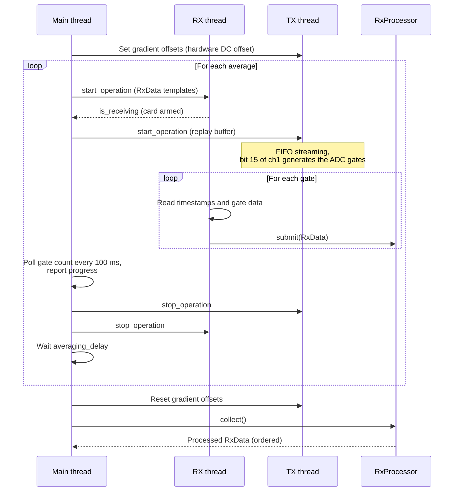

# Acquisition

An acquisition is executed by [`AcquisitionControl.run`][console.spcm_control.acquisition_control.AcquisitionControl.run] after the sequence has been unrolled by `set_sequence`. The transmit card replays the unrolled sequence while the receive card records one gate per ADC event. Each average is a complete replay of the sequence.

## Sequence of operations

| Step | Description |
|---|---|
| Gradient offsets | `AcquisitionParameter.gradient_offset` is written to the offset registers of TX channels 1–3 before the first average and reset to zero after the last |
| Arming | The RX card is started first and waits for the first gate; the TX card is started when the RX thread signals readiness |
| Start | The TX card uses a software trigger, i.e. replay begins immediately after the card is started |
| Completion | An average ends when the number of received gates equals the number of ADC events, or after a timeout of 5 s plus the sequence duration |
| Progress | An optional `progress_callback(percent)` is called from the polling loop |
| Averages | Averages are not summed; each average yields its own set of `RxData` objects with `average_index` |

As both cards are stopped as soon as the last gate has been received, sequence blocks after the last ADC event (e.g. a final TR delay) are not necessarily played out completely. The interval between averages is given by the restart of the cards plus `averaging_delay`.

## Transmit card: FIFO streaming

The transmit card is operated in FIFO single mode. A background thread transfers the replay buffer from host memory to the card:

| Parameter | Value |
|---|---|
| Ring buffer | Size of the sequence, at most 1 GiB, page-aligned DMA buffer |
| Notify size | 1/16 of the ring buffer, at least 4096 bytes |
| Procedure | Pre-fill the ring buffer, start DMA and card, then refill in chunks of the notify size whenever the card has consumed them |
| End of sequence | The last chunk is zero-padded, so all outputs return to 0 V |

Sequences longer than the on-board memory are therefore replayed without interruption, provided that the host transfers data faster than the card consumes them (8 bytes per sample, e.g. 160 MB/s at 20 MHz).

## Receive card: gated recording

The receive card is operated in gated FIFO mode, i.e. it records data only while the ADC gate is high. A background thread processes the data stream:

| Parameter | Value |
|---|---|
| Trigger | Positive edge of the ADC gate at the external trigger input |
| Gate boundaries | Two timestamps per gate (start and end), 64-bit values in 16-byte records |
| Pre-trigger | 8 samples per gate, removed during readout |
| Data buffer | 1 GiB DMA ring buffer, notify size 4 KiB; buffer wrap-around is handled during readout |
| Phase reference | Bit 15 of channel 0 (sampled X2 input), first ≤ 1000 samples; bit 15 is removed from the analog data afterwards |

For each gate, the thread stores the raw samples, the phase reference and the timestamp in the corresponding `RxData` template and submits it for processing (see [Signal flow](signal-flow.md)).

## Remote operation

The `nexus` command starts an acquisition service that connects the cards once and serves the [`AcquisitionControl`][console.spcm_control.acquisition_control.AcquisitionControl] instance via [`AcquisitionControlManager`][console.service.acquisition_manager.AcquisitionControlManager] (Python `multiprocessing` manager, default `localhost:50000`). Clients connect to the service and call `set_sequence` and `run` as for a local instance (see [Remote acquisition](../examples/remote_acquisition.md)). The command line options are documented in [`start_manager.main`][console.service.start_manager.main].
