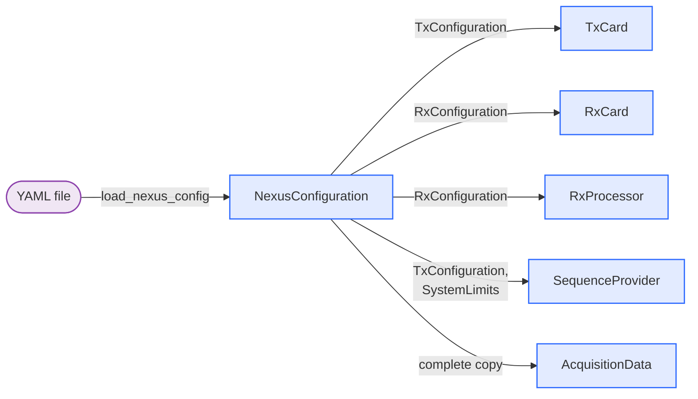

# Device configuration

The device configuration describes the hardware of the MRI system: the measurement cards, the amplifiers, the gradient coils and the system limits. It is read from a YAML file when [`AcquisitionControl`][console.spcm_control.acquisition_control.AcquisitionControl] is created and remains fixed for the session. Parameters that change between measurements, such as the Larmor frequency, are passed with every sequence as [`AcquisitionParameter`][console.interfaces.acquisition_parameter.AcquisitionParameter].



The file is validated by [`NexusConfiguration`][console.interfaces.device_configuration.NexusConfiguration] and consists of the three sections described below. Unknown keys are ignored. A copy of the complete configuration is stored with every acquisition in `meta["device_configuration"]`.

## TxConfiguration

Transmit card (AWG), validated by [`TxConfiguration`][console.interfaces.device_configuration.TxConfiguration]. `channel_max_amplitude` and `channel_filter_type` have four entries in the order [RF, gradient 1, gradient 2, gradient 3]; `gradient_efficiency` and `gpa_gain` have three entries, one per physical gradient channel.

| Attribute | Unit | Description |
|---|---|---|
| `device_path` | – | Device path of the transmit card, e.g. `/dev/spcm1` |
| `sampling_rate` | MHz | Sampling rate as integer; must equal `RxConfiguration.sampling_rate`, as the transmit card runs on the clock of the receive card (not checked by the software) |
| `channel_max_amplitude` | mV | Output range per channel, 1–6000 mV into 50 Ω |
| `channel_filter_type` | – | Output filter setting per channel, 0–3 (see card manual) |
| `rf_terminated_50ohm` | – | `true` if the RF output is terminated into 50 Ω, `false` for high impedance (the output voltage doubles) |
| `gradients_terminated_50ohm` | – | `true` if the gradient outputs are terminated into 50 Ω, `false` for high impedance (the output voltage doubles) |
| `gradient_efficiency` | T/m/A | Gradient coil efficiency per physical gradient channel |
| `gpa_gain` | A/V | Transconductance of the gradient power amplifier per physical gradient channel |
| `rf_to_mvolt` | mV/Hz | Conversion of the PyPulseq RF amplitude to the output voltage |
| `rf_gain_lut_path` | – | Optional, default none. Path to a lookup table for the linearization of the RF power amplifier (`.npy`, 65536 int16 values) |

## RxConfiguration

Receive card (digitizer), validated by [`RxConfiguration`][console.interfaces.device_configuration.RxConfiguration]. All channel lists must have `max_available_channels` entries. As the receive card setup expects 8 entries per list, `max_available_channels` must currently be 8, also for cards with fewer channels.

| Attribute | Unit | Description |
|---|---|---|
| `device_path` | – | Device path of the receive card, e.g. `/dev/spcm0` |
| `sampling_rate` | MHz | Sampling rate as integer; the receive card is the clock master and provides this clock to the transmit card |
| `max_available_channels` | – | Number of input channels of the card and length of all channel lists (8 for the M2p.5933-x4) |
| `channel_enable` | – | Enable flag per channel; 1, 2, 4 or 8 channels must be enabled |
| `channel_max_amplitude` | mV | Input range per channel: 200, 500, 1000, 2000, 5000 or 10000 |
| `channel_terminated_50ohm` | – | Input termination per channel, `true` for 50 Ω, `false` for high impedance |
| `num_processing_workers` | – | Optional, default 1. Number of worker processes for the parallel processing of the receive data; 0 processes the data in the main process after the acquisition |

## SystemLimits

Limits of the MR system, validated by [`SystemLimits`][console.interfaces.device_configuration.SystemLimits] and passed to PyPulseq as `Opts` (`AcquisitionControl.get_sequence_system()`). `max_grad`, `max_slew`, `block_duration_raster`, `grad_raster_time` and `adc_raster_time` must be positive, all other values must not be negative. Numbers in exponent notation need a decimal point, e.g. `20.e-6`: YAML reads `20e-6` as a string, which the model rejects.

| Attribute | Unit | Description |
|---|---|---|
| `max_grad` | Hz/m | Maximum gradient amplitude |
| `max_slew` | Hz/m/s | Maximum gradient slew rate |
| `rf_dead_time` | s | Dead time before an RF pulse; the RF unblanking signal is set this time before the pulse |
| `rf_ringdown_time` | s | Ring-down time after an RF pulse |
| `adc_dead_time` | s | Dead time around an ADC event; the ADC gate is extended by this time on both sides |
| `block_duration_raster` | s | Raster time of block durations |
| `rf_raster_time` | s | Raster time of RF waveforms |
| `grad_raster_time` | s | Raster time of gradient waveforms |
| `adc_raster_time` | s | Raster time of ADC dwell times |
| `B0` | T | Optional, default 0.05. Static magnetic field strength |

## Example

The example configuration of the repository must be adapted to the target system.

```yaml title="examples/example_device_config.yaml"
--8<-- "examples/example_device_config.yaml"
```
