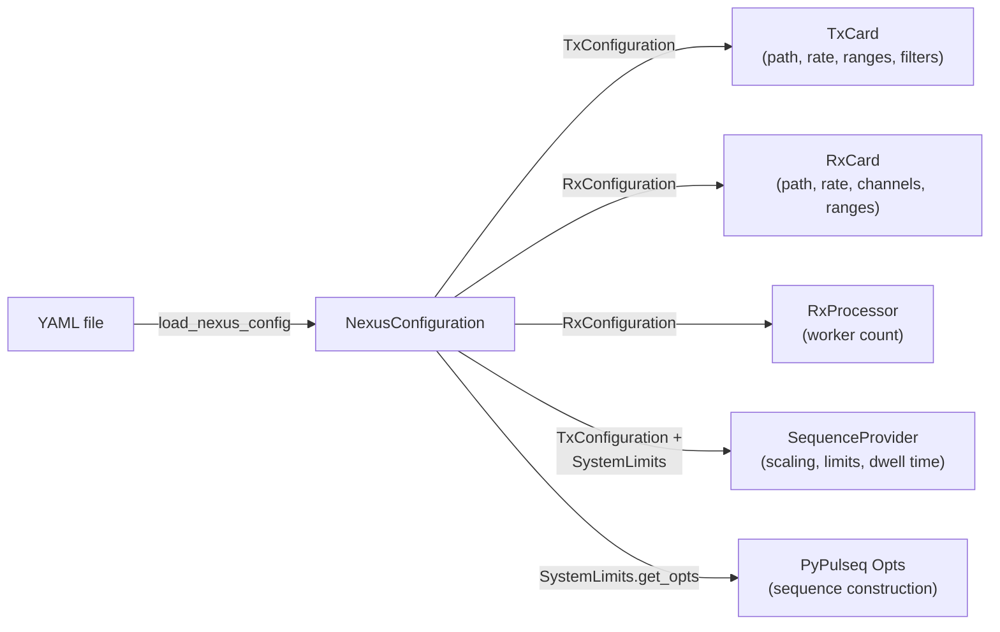

# Device configuration

The console distinguishes between two kinds of parameters:

| | Device configuration | Acquisition parameter |
|---|---|---|
| Describes | Hardware: cards, amplifiers, coils, system limits | Measurement state: Larmor frequency, B1 scaling, gradient offsets, averages, ... |
| Format | YAML file, validated by [`NexusConfiguration`][console.interfaces.device_configuration.NexusConfiguration] | [`AcquisitionParameter`][console.interfaces.acquisition_parameter.AcquisitionParameter], persisted as JSON |
| Lifetime | Loaded once when [`AcquisitionControl`][console.spcm_control.acquisition_control.AcquisitionControl] is created | Passed with every call to `set_sequence`; available as `console.parameter` |
| Stored with data | `meta["device_configuration"]` | `meta["acquisition_parameter"]` |

## Configuration file

The configuration file consists of the three sections `TxConfiguration`, `RxConfiguration` and `SystemLimits`. The reference configuration of the repository is reproduced below; it must be adapted to the target system.

```yaml title="examples/example_device_config.yaml"
--8<-- "examples/example_device_config.yaml"
```

The meaning and unit of each key are documented with the configuration models: [`TxConfiguration`][console.interfaces.device_configuration.TxConfiguration], [`RxConfiguration`][console.interfaces.device_configuration.RxConfiguration] and [`SystemLimits`][console.interfaces.device_configuration.SystemLimits].

## Use of the configuration



| Quantity | Derived from |
|---|---|
| Sampling interval of the replay buffer | `1 / TxConfiguration.sampling_rate` |
| Effective output limits | `channel_max_amplitude`, doubled for outputs terminated into high impedance |
| Gradient scaling (Hz/m → mV) | `gradient_efficiency`, `gpa_gain` (see [Sequence unrolling](sequence-unrolling.md#gradients)) |
| RF scaling (Hz → mV) | `rf_to_mvolt`, optionally followed by the `rf_gain_lut_path` lookup table |
| RX scaling (ADC value → mV) | `RxConfiguration.channel_max_amplitude / 2**15` |
| Sequence timing limits | `SystemLimits`, returned as PyPulseq `Opts` by `AcquisitionControl.get_sequence_system()` |

## Constraints

The following constraints are enforced when the configuration is loaded or the cards are set up:

| Constraint | Checked by |
|---|---|
| TX output range 1–6000 mV per channel, filter setting 0–3 | Configuration model |
| RX input range one of 200, 500, 1000, 2000, 5000, 10000 mV | Configuration model |
| RX channel lists have length `max_available_channels` | Configuration model |
| RX channel lists have exactly 8 entries; 1, 2, 4 or 8 channels enabled | RX card setup |
| `SystemLimits` values are floats (write `20.e-6`, not `20e-6`, which YAML reads as string) | Configuration model |
| Card types M2p.65xx (TX) and M2p.59xx (RX) | Card setup |

The following condition is not checked by the software and must be ensured by the user:

- **Identical sampling rates.** `TxConfiguration.sampling_rate` must equal `RxConfiguration.sampling_rate`, as the TX card is clocked by the RX card.

## Acquisition parameter

The acquisition parameter holds the runtime state of a measurement session. On import of the `console` package, the last saved state is loaded from `<home>/nexus-console/acquisition-parameter.state` and exposed as `console.parameter`. Every modification is type-checked and saved immediately, so calibration results (e.g. Larmor frequency, B1 scaling) persist between sessions. The individual fields are documented in [`AcquisitionParameter`][console.interfaces.acquisition_parameter.AcquisitionParameter].
