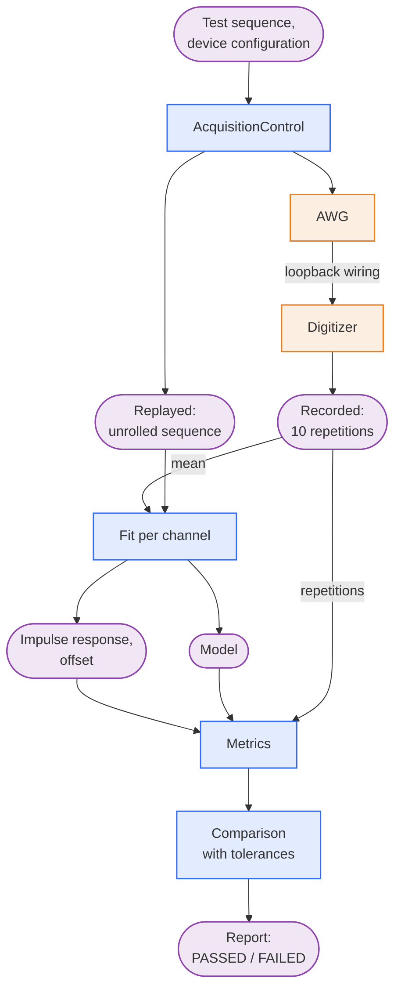

# Loopback Test

Most of the Nexus console functionality is covered by unit tests, which are located in the `/tests` folder and implemented with `pytest`.
The unit tests are designed to cover as many lines as possible without access to the measurement cards.
The operation of [`TxCard`][console.spcm_control.tx_device.TxCard] and [`RxCard`][console.spcm_control.rx_device.RxCard] mostly consists of reading and writing values on the hardware modules.
Meaningful tests therefore require the physical cards, which continuous integration with pytest cannot provide.
The same applies to most of the [`AcquisitionControl`][console.spcm_control.acquisition_control.AcquisitionControl], which orchestrates the operation of the `TxCard` and `RxCard`.
For this reason, `/tests/hardware/loopback.py` implements an end-to-end test with an AWG and a digitizer in a loopback configuration.
The four analog outputs of the AWG are connected directly to four analog inputs of the digitizer, according to the following wiring table.

| AWG (TX) | Signal | Digitizer (RX) |
|---|---|---|
| ch0 | RF | ch0 |
| ch1 | Gx | ch1 |
| ch2 | Gy | ch2 |
| ch3 | Gz | ch3 |
| X1 | ADC gate | X1 |
| X2 | Phase reference | X2 |
| Clk In | Sampling clock | Clk Out |
| X3 | RF unblanking | unconnected |

!!! warning
    Switch off or disconnect any amplifiers before you change the wiring. Restore the default wiring of the cards, amplifiers and coils before the next MRI measurement.

To execute the loopback test, run the following command from the repository root. A detailed module description can be found in the [API reference](../api_reference/hardware_tests/loopback.md). The script prints the required wiring and waits for confirmation before the cards are started.

```
python tests/hardware/loopback.py
```

| Option | Description |
|---|---|
| `-v` | Prints the metrics of all channels and the errors per ADC gate, and plots the recorded signals and the residual |
| `--save PATH` | Saves the measurement and the system information to a `.npz` file. `Measurement.load(PATH)` loads it for an analysis without the cards |


## Test setup

### Sequence

[`build_sequence`][loopback.build_sequence] creates a Pulseq sequence with three test cases. Each test case is a block with an ADC event, preceded by a delay block.
All analog waveforms have a peak amplitude of 160 mV, which is 80 % of the configured 200 mV channel range.
Each ADC gate starts 75 µs after the start of its block (`adc_dead_time`) and lasts until the end of the block's events.

| Block | ADC | Events | Purpose |
|---|---|---|---|
| 1 | – | Delay, 1 ms | Separates the test cases, so that each block starts from a settled, zero output |
| 2 | 0 | Delay, 800 µs | Empty ADC gate: The analog outputs are zero, measures noise and offset |
| 3 | – | Delay, 1 ms | Separation |
| 4 | 1 | Gx: trapezoid<br>Gy: neg. sin² shape<br>Gz: piecewise linear | Gain, offset and distortion of the gradient channels, the shape and sign differ per channel to detect mix-ups |
| 5 | – | Delay, 1 ms | Separation |
| 6 | 2 | 200 µs RF block pulse (f0 = 2 MHz) + gradients of block 4 | All event types in parallel. The carrier and the steep pulse edges determine the response and latency of the RF channel, crosstalk between RF and gradients shows up in the residual |

### Device configuration

The test defines its own device configuration in [`device_config`][loopback.device_config] instead of loading a configuration file to simplify the execution and guarantee comparable results on different systems. Only the device paths and the number of RX channels are taken from the detected cards. The most important differences from `examples/example_device_config.yaml` are:

- 4 transmit channels configured with a maximum output amplitude of 200 mV and termination into 50 ohms
- Output filter 0 of the transmit channels which yields the widest filter (70 MHz, 3rd-order Butterworth), see M2p.65xx manual, *Output Filters*
- 4 receive channels enabled and configured with a maximum input amplitude of 200 mV and termination into 50 ohms
- Different `gpa_gain` and `gradient_efficiency` conversions per channel, but identical gradient amplitudes 
- 75 us `adc_dead_time`

### Acquisition parameters

- `larmor_frequency = 2e6` for 2 MHz RF pulse
- `b1_scaling = 1.6` which yields 160 mV block pulse amplitude
- `num_averages = 10` to analyse repetition spread
- `state_filepath` is set to a temporary directory which is deleted after the test

The test runs the acquisition with `store_unprocessed=True`, so the raw ADC data at the full sampling rate of 20 MHz is kept. The analysis compares it sample by sample with the replayed sequence.

## Pipeline

The AWG replays the test sequence ten times, and the digitizer records the three ADC gates of each repetition. The analysis compares the recordings with the unrolled sequence, the samples that the AWG was instructed to output.



## Model and fit

### Why the data are fitted

Even with perfect hardware, the recorded signal does not equal the replayed signal exactly. The calibrations of AWG and digitizer differ slightly, both cards have a small DC offset, the analog filters smooth the signal, and the signal path delays it slightly. These deviations are expected and specified in the manuals (see [Hardware Documentation](../references.md#hardware-documentation)). A direct comparison of the samples would not distinguish them from actual faults.

The test therefore fits a model that contains the expected deviations, and evaluates two things:

- **Fit parameters:** the expected deviations must be within the specifications of the cards. This gives the gain error, offset and RF latency.
- **Residual:** the difference between recording and model contains everything the model cannot cover, such as distortion, crosstalk, glitches, dropped samples or timing jitter. It must stay at a level similar to the noise.

### Model

Each recorded sample is modeled as a weighted sum of seven neighboring replayed samples plus an offset:

$$
y[k] = \sum_{j=-3}^{3} h_j \, x[n_k - d - j] + c
$$

| Symbol | Meaning |
|---|---|
| $y[k]$ | Recorded sample $k$ in mV, mean of the 10 repetitions |
| $x[n]$ | Replayed sample $n$ of the unrolled sequence in mV |
| $n_k$ | Position of the recorded sample $k$ in the unrolled sequence |
| $d$ | Delay of the recording in whole samples |
| $h_j$ | Impulse response of the signal path from DAC to ADC, seven samples |
| $c$ | Offset in mV |

The model is a discrete-time FIR filter applied to the replayed sequence. Gain and RF latency follow from the impulse response:

- **Gain** $g = \sum_j h_j$, the response at DC. A gain of 1 means that the calibrations of AWG and digitizer match perfectly.
- **RF latency** $\tau = \sum_j (d + j)\, h_j \,/\, g$, the centroid of the impulse response of the RF channel. It is the delay that the envelope of an RF pulse experiences, relative to the ADC gate. A negative value means that the recording starts slightly later than the gate in the unrolled sequence.

### Signal path from DAC to ADC

The AWG outputs each sample as a constant value for one sample period, without interpolation (M2p.65xx, *Technical Data → Analog Outputs*). The analog filters slightly smooth these steps: the 70 MHz output filter of the AWG (M2p.65xx, *Output Filters*) and the anti-aliasing filter of the digitizer, 10 MHz for the 592x and 20 MHz for the 593x (M2p.59xx, *Technical Data → Analog Inputs*). Both filters are at or above the Nyquist frequency of 10 MHz, so they round off the edges of the steps but do not remove them. The digitizer then samples the smoothed signal. Since each step is spread over a few sample periods, a recorded sample contains contributions of a few consecutive replayed samples. The AWG runs on the sampling clock of the digitizer, so the ADC samples at the same position within every step, and the contributions are given by the same weights $h_j$ for every recorded sample. This corresponds to the FIR model above. The time offset may differ between setups, so the weights are fitted rather than predefined.

The FIR filter has seven coefficients, three on each side of the center. The number follows from the settling time of the slowest filter, the 3rd-order Butterworth anti-aliasing filter of the 592x at 10 MHz (M2p.59xx, Technical Data → Analog Inputs): its ringing decays with a time constant of 1/(π · 10 MHz) ≈ 32 ns, so the response to one replayed sample extends over about four sample periods. Seven coefficients cover this response for both digitizer models and keep the number of fit parameters small.

### Fit procedure

[`fit_channel`][loopback.fit_channel] fits each channel independently and uses the mean of the 10 repetitions, which reduces the noise.

1. **Delay $d$:** the recording can be shifted by whole samples relative to the replay, so the shift with the highest cross-correlation (searched within ±32 samples) is used to center the seven FIR coefficients $h_j$ on the recorded response.
2. **Impulse response and offset:** the model is linear in $h_j$ and $c$. A single linear least-squares solution gives both, without start values or iterations.

!!! note "Timing of the gradient channels"
    The delay is fitted per channel, so a timing shift of a gradient channel relative to the RF channel is absorbed by the fit and is not tested. Both manuals specify a skew between channels of less than 200 ps (*Technical Data → Clock*), which is 0.004 samples at 20 MS/s. Timing errors that matter for MRI originate in the sequence calculation, which is covered by the unit tests.

## Metrics and tolerances

### Metrics

[`analyze`][loopback.analyze] evaluates the following seven metrics per channel. The RF latency is only evaluated on the RF channel. Model is the fitted right-hand side of the model equation, mean is the mean of the 10 repetitions, and A is the channel amplitude (160 mV).

| Metric | Definition | Indicates |
|---|---|---|
| Gain error | Σ h<sub>j</sub> − 1 | Calibration mismatch between AWG and digitizer |
| Offset | c / 200 mV | DC offset of the output or input stage |
| RF latency | τ, in samples | RF channel shifted relative to the ADC gate |
| Noise | RMS(single repetitions − model) / A, in gate 0 | Noise of both cards |
| RMS error | RMS(mean − model) / A | Distortion, nonlinearity or crosstalk that affect the whole signal |
| Peak error | max(abs(mean − model)) / A | Local faults, e.g. a single wrong sample, which barely change the RMS error |
| Repetition spread | max(std(repetitions)) / A | Timing jitter and dropped samples. Without faults, the spread is close to the noise |

### Tolerances

The tolerances follow from the technical data of the AWG (M2p.65xx) and the digitizer (M2p.59xx) at the ±200 mV range with 50 Ω termination. Guaranteed values are used directly, typical values with a margin of a factor ~2.

| Metric | Tolerance | Values in the manuals |
|---|---|---|
| Gain error | ±0.6 % | AWG output accuracy (0.5 % of amplitude) + digitizer gain error (0.1 %) |
| Offset | ±0.6 % | AWG output accuracy (1 mV) + digitizer offset error (0.1 % of range) |
| RF latency | −0.5 ±0.5 samples | Digitizer trigger accuracy (1 sample), center measured on the development setup |
| Noise | ±0.1 % | Digitizer noise and AWG noise density |
| RMS error | ±0.1 % | Noise, harmonic distortion (THD) and integral nonlinearity (INL) of both cards |
| Peak error | ±0.3 % | As RMS error, for the largest deviation among all samples |
| Repetition spread | ±0.25 % | Noise, for the largest spread among all samples |


## Test result

| Entry | Content |
|---|---|
| Time stamp | Date and time of the test |
| OS, Python | Operating system and Python version of the workstation |
| Code version | Nexus-console version, git branch and commit of the tested code. `(uncommitted changes)` indicates that tracked files differ from the commit |
| SPCM driver | Versions of the driver library and the kernel driver |
| Spectrum cards | Model, function and number of channels of each detected card |
| Recording | Number of recorded ADC gates out of the expected number. Missing gates, a wrong number of samples or a recorded phase reference that does not oscillate at the frequency of the phase reference signal abort the test before the analysis. The phase reference is checked with the magnitude of the same demodulation that the phase correction in `RxData` uses, the threshold detects frequency errors above about 0.4 % |
| Metrics | Worst value of all channels per metric, the tolerance and the final test result |


The result is only meaningful together with the system on which it was obtained. The commit identifies the exact state of the code such that a reviewer can verify that the result belongs to the latest changes of the pull request. The driver version and operating system may affect the operation of the cards. If a result changes between two pull requests, the system information shows whether the code or the system has changed.

### Report in pull requests

The unit tests in the continuous integration cannot access the cards, so the loopback test is the only check that a change does not break the operation of the hardware. The pull request template therefore asks for the result of every pull request. It is essential for changes to the card control (`console.spcm_control`), the sequence calculation, the device configuration and the acquisition parameters, and after updates of dependencies or the Spectrum driver.

- Run the test with the final state of the pull request. The reported commit should match the last commit of the pull request and must not show `(uncommitted changes)`.
- Copy the complete result, from the header line to `Result`, into the section *Loopback test* of the pull request.
- All metrics must pass. If a metric fails, rerun the test with `-v` to see which channel and which ADC gate cause the failure, and check the wiring first.
