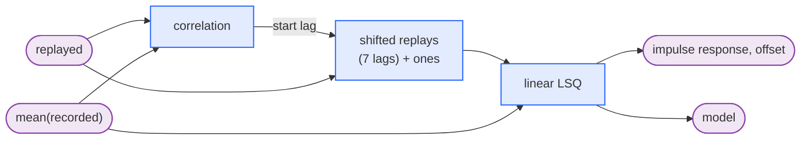
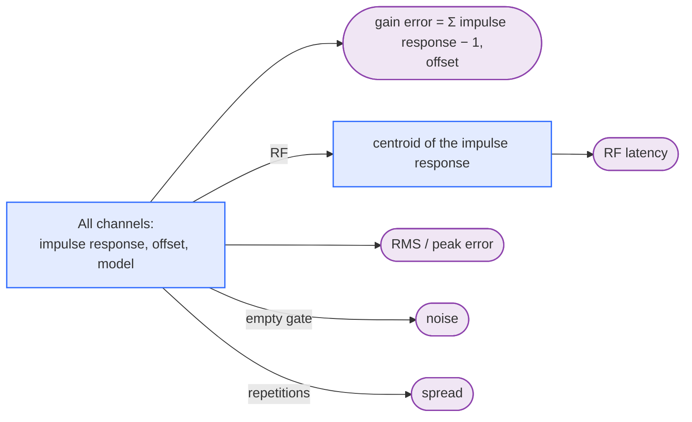

# Loopback Test

Most of the Nexus console functionality is covered by unit tests, which are located in the `/tests` folder and implemented with `pytest`.
The unit tests are designed to cover as many lines as possible without access to the measurement cards.
The operation of [`TxCard`][console.spcm_control.tx_device.TxCard] and [`RxCard`][console.spcm_control.rx_device.RxCard] mostly consists of reading and writing values on the hardware modules.
Meaningful tests therefore require the physical cards, which continuous integration with pytest cannot provide.
The same applies to most of the [`AcquisitionControl`][console.spcm_control.acquisition_control.AcquisitionControl], which orchestrates the operation of the `TxCard` and `RxCard`.
For this reason, `/tests/hardware/loopback.py` implements an end-to-end test with an AWG and a digitizer in a loopback configuration.
The four analog outputs of the AWG are connected directly to four analog inputs of the digitizer, according to the following wiring table.

| AWG (TX) | Signal | Digitizer (RX) |
|---|---|---|
| ch0 | RF | ch0 |
| ch1 | Gx | ch1 |
| ch2 | Gy | ch2 |
| ch3 | Gz | ch3 |
| X1 | ADC gate | X1 |
| X2 | Phase reference | X2 |
| Clk In | Sampling clock | Clk Out |
| X3 | RF unblanking | not connected |

!!! warning
    Switch off or disconnect any amplifiers before you change the wiring. Restore the default wiring of the cards, amplifiers and coils before the next MRI measurement.

This chapter walks through the loopback test, especially through the analysis, from the data to the metrics. Additional documentation of the module can be found in the [API reference](../api_reference/hardware_tests/loopback.md).
To execute the loopback-test run the following command from the repository root.
```
python tests/hardware/loopback.py
```
The script prints the required wiring and waits for confirmation. It reports the worst value of all channels per metric.
Copy this report into the pull request to proof that your changes don't break the consol functionality.

- `-v` (verbose) prints the values of all channels and the errors per ADC gate, and plots the recorded signals and the residual.
- `--save PATH` saves the measurement to a `.npz` file. It can be loaded without access to the cards for additional checks using `Measurement.load(PATH)`.

## 1. Test sequence

[`build_sequence`][loopback.build_sequence] creates a Pulseq sequence with three test cases. Each test case is a block with an ADC event, preceded by a delay block.
All analog waveforms have a peak amplitude of 160 mV, which is 80 % of the configured 200 mV channel range.
Each ADC gate starts 75 µs after the start of its block (`adc_dead_time`) and lasts until the end of the block's events.

| Block | ADC | Events | Purpose |
|---|---|---|---|
| 1 | – | Delay, 1 ms | Separates the test cases, so that each block starts from a settled, zero output |
| 2 | 0 | Delay, 800 µs | Empty gate: ADC gate and phase reference are active, the analog outputs are zero. Measures noise, offset and crosstalk of the digital signals |
| 3 | – | Delay, 1 ms | Separation |
| 4 | 1 | Gx: trapezoid<br>Gy: negative sin² shape<br>Gz: piecewise linear | Gain, offset and distortion of the gradient channels. The shape and sign differ per channel, so swapped channels are detected |
| 5 | – | Delay, 1 ms | Separation |
| 6 | 2 | 200 µs block pulse (flip angle 2π) with a 2 MHz carrier, together with the gradients of block 4 | All event types in parallel, including the RF unblanking. The carrier and the steep pulse edges determine the response and latency of the RF channel, crosstalk between RF and gradients shows up in the residual |

### Device configuration

The test defines its own device configuration in [`device_config`][loopback.device_config] instead of loading a configuration file to simplify the execution and guarantee comparable results on different systems. Only the device paths and the number of RX channels are taken from the detected cards. The most important differences from `examples/example_device_config.yaml` are:

- 4 transmit channels configured with a maximum output amplitude of 200 mV and termination into 50 ohms
- Output filter 0 of the transmit channels, the widest filter (70 MHz, 3rd-order Butterworth). The AWG has no unfiltered path, the filter is always located between DAC and output amplifier (M2p.65xx manual, *Output Filters*)
- 4 receive channels enabled and configured with a maximum input amplitude of 200 mV and termination into 50 ohms
- Different `gpa_gain` and `gradient_efficiency` conversions per channel, but identical gradient amplitudes 
- 75 us `adc_dead_time`

### Acquisition parameters

- `larmor_frequency = 2e6` for 2 MHz RF pulse
- `b1_scaling = 1.6` which yields 160 mV block pulse amplitude
- `num_averages = 10` to analyse repetition spread
- `state_filepath` is set to a temporary directory which is deleted after the test

The test runs the acquisition with `store_unprocessed=True`, so the raw ADC data at the full sampling rate of 20 MHz is kept. The analysis compares it sample by sample with the replayed sequence.

---


## 2. The question the analysis answers

The TX card replays a known waveform and the RX card records it through a direct wired connection. With perfect hardware, every recorded sample would equal the replayed sample. Real hardware differs from that in a few predictable ways. The table lists them together with the statements of the hardware manuals they are based on (see [Hardware Documentation](../references.md#hardware-documentation)).

| Effect | Physical cause | Source |
|---|---|---|
| Gain | DAC and ADC calibration don't match exactly | M2p.65xx: output accuracy ±0.5 % of amplitude; M2p.59xx: gain error 0.1 % of reading |
| Offset | DC offset of the output or input stage | M2p.65xx: output accuracy ±1 mV; M2p.59xx: offset error 0.1 % of range |
| Sampled DAC → ADC response | The DAC holds each value for one sample period, the analog filters smooth the steps, and the ADC reads the result at a fixed phase of the shared clock. Pipeline latencies of the cards add whole samples. | M2p.65xx: *no interpolation*, filter 0 70 MHz; M2p.59xx: anti-aliasing filter 10 MHz (592x) or 20 MHz (593x); shared sampling clock |

The analysis builds a model that contains **exactly these effects and nothing else**. It fits the model to the measurement and then asks two things:

1. Are the fitted effects within tolerance? This gives the gain error, offset and RF latency.
2. Is anything left over that the model can't explain? This gives the RMS error, peak error, noise and repetition spread. A leftover means distortion, glitches, dropped samples or jitter, which a linear model can't produce.

That split is the core idea. Expected imperfections go into the fit parameters, and real faults show up as residual.

---

## 3. The input data (`Measurement`)

- **`replayed`**, shape (4, all sequence samples): what the DAC was told to output, in mV, at every sample of the whole sequence. Delays between the gates are included.
- **`recorded`**, shape (10 repetitions, 4, recorded samples): what the ADC saw, in mV. It only exists inside the ADC gates, and the 3 gates are joined end to end.
- **`index`**: for each recorded sample, its position in the replayed timeline. This is the bridge between the two arrays: `recorded[..., k]` belongs to `replayed[:, index[k]]`.

Both cards run at 20 MHz from one shared clock (RX Clk Out → TX Clk In). A "sample" is therefore the same time unit on both sides, and a delay can be stated in samples.

The three gates each test something different:

0. **Empty** gate: no output. It measures noise and crosstalk.
1. **Gradients**: a different slow shape on each channel.
2. **Everything at once**: an RF pulse plus the gradients.

---

## 4. The sampled DAC → ADC response

### What the manuals say

| Manual, section | Statement | Meaning for the test |
|---|---|---|
| M2p.65xx, *Technical Data → Analog Outputs* | D/A interpolation: no interpolation | The DAC holds each sample for one sample period, its output is a staircase |
| M2p.65xx, *Bandwidth and Filters* | Analog bandwidth does not include the sinc response of the DAC. Filter 0: 70 MHz, third-order Butterworth | The staircase is smoothed by a filter far above the Nyquist frequency of 10 MHz |
| M2p.65xx, *Output Filters* | The filter is located between DAC and output amplifier | There is no unfiltered path, filter 0 is the widest setting |
| M2p.59xx, *Technical Data → Analog Inputs* | Anti-aliasing filter, fixed, 3rd-order Butterworth alike: 10 MHz for the 592x (20 MS/s), 20 MHz for the 593x (40 MS/s) | The anti-aliasing filter is designed for the maximum sampling rate of the card. At 20 MS/s it lies at (592x) or above (593x) the Nyquist frequency and does **not** suppress aliases |
| M2p.59xx, *Clock Limitations and Bandwidth* | −3 dB analog input bandwidth > 10 MHz (592x), > 20 MHz (593x) | Same conclusion for the complete input path |
| Both, *Multi Purpose I/O lines* and clock setup | The AWG runs on the clock of the digitizer, synchronous digital lines are updated with the sampling clock | DAC updates and ADC samples have a fixed phase relation |

### Why the sample-and-hold doesn't show up as a sinc

Seen as a continuous signal, the staircase of the DAC has the spectrum of the samples multiplied by a sinc (the Fourier transform of the one-sample hold), and it contains images of the signal around every multiple of the sampling rate. A 2 MHz carrier, for example, also appears at 18 MHz and 22 MHz. An analog filter below the Nyquist frequency would remove these images, and the ADC would then see only the base band with the sinc droop.

The manuals show that this is not the case here. No filter lies below 10 MHz, so the images reach the ADC: the 18 MHz image of a 2 MHz carrier keeps about 17 % of its amplitude with the 10 MHz filter of the 592x and about 80 % with the 20 MHz filter of the 593x. Because the ADC samples with the same clock as the DAC, every image folds back exactly onto the base band, with a fixed phase. The folded images cancel the sinc droop. In the time domain this is easier to see: the ADC reads the smoothed staircase once per sample period, always at the same position within a step. Each recorded sample is therefore a weighted sum of a few replayed samples:

```
recorded[k] = Σ_j impulse_response[j] · replayed[index[k] − lags[j]] + offset
```

This is a discrete-time FIR filter. Its coefficients are the sampled impulse response of the DAC → ADC path: the analog response to a single held sample, read at the clock phase between DAC and ADC. A simulation of the chain with the filters from the manuals (hold → 70 MHz Butterworth → 20 MHz Butterworth of the 593x → sampling) gives, depending on the clock phase:

| Clock phase | Impulse response (largest sample and its neighbor) | Behavior |
|---|---|---|
| ADC samples shortly after a DAC step | 1.06, −0.06 | Nearly a pure delay, the overshoot of the filters even lifts the response at Nyquist to 1.12 |
| ADC samples in the middle of the edge | 0.67, 0.31 | Strong low-pass |
| ADC samples shortly before the next DAC step | 0.10, 0.90 | Nearly a pure delay, one sample later |

A model with a sinc factor in the base band can't describe this. It predicts a droop of −3.9 dB at Nyquist, while the real response may even rise. A parametric low-pass would have to compensate the missing droop with a resonance, and its parameters would lose their meaning. In the simulation this biased the fitted RF gain by up to ±0.9 % and left up to 0.9 % peak error. The FIR describes all clock phases exactly.

### Why seven samples of the impulse response

The response of one DAC sample is as long as the filters need to settle. The AWG filter (70 MHz) has a rise time of about 5 ns. The ADC anti-aliasing filter is the slower one: about 18 ns for the 20 MHz filter of the 593x and about 35 ns for the 10 MHz filter of the 592x, compared with a sample period of 50 ns. In the simulation of the 592x, an impulse response of five samples leaves a model error of up to 0.6 % at unfavorable clock phases, above the peak error tolerance. Seven samples keep it below 0.1 % at all clock phases. `RESPONSE_HALF_WIDTH = 3` therefore allows three samples before and after the center of the impulse response, which covers the response of both digitizer models while keeping the fit well-determined.

---

## 5. The fit (`fit_channel`)

The fit has to find the impulse response and the offset. Both enter the model linearly, so a single linear least-squares step solves it. There is no iteration, start value or bound, apart from the placement of the impulse response.

### Step 1: place the impulse response with cross-correlation

```python
search = np.arange(-MAX_DELAY, MAX_DELAY + 1)            # −32 … +32
start = search[np.argmax([recorded @ replayed[index - lag] for lag in search])]
lags = start + np.arange(-RESPONSE_HALF_WIDTH, RESPONSE_HALF_WIDTH + 1)
```

For each whole-sample shift, the recorded signal is compared with the replayed signal shifted by that lag, using a dot product (correlation). The best-matching shift has the largest value, and the seven samples of the impulse response are centered on it.

**Why it's needed:** the pipeline latencies of the cards shift the recording by several samples, but the impulse response only covers ±3 samples. On the RF channel the signal is an oscillating carrier, and a carrier shifted by one full period looks almost the same. The correlation is a cheap *global* search over all whole-sample shifts. The edges of the pulse envelope make the correct period win.

**Sign:** `replayed[index - lag]` means that a positive lag is a recording that arrives later than the replay.

### Step 2: impulse response and offset by linear least squares

```python
design = np.column_stack([*(replayed[index - lag] for lag in lags), np.ones(index.size)])
coefficients = np.linalg.lstsq(design, recorded)[0]     # (impulse_response..., offset)
```

The design matrix has one column per lag, the replayed sequence shifted by that lag and taken at the recorded samples, and a column of ones for the offset. `lstsq` returns the impulse response and the offset that minimize the squared residual, and `design @ coefficients` is the fitted model.

The shifted columns read the replayed sequence directly, also just before a gate. A recorded sample at the start of a gate therefore correctly depends on the replayed samples before it.

---

## 6. Each channel is fitted independently

All channels use the same model and are fitted independently. Slow gradient shapes don't determine the individual samples of the impulse response, but they don't need to: the model of a slow signal depends almost only on its sum (the gain).

### Why the test doesn't check the timing of the gradient channels

The fit of each channel finds its own delay, so a gradient channel that is shifted against RF does not show up in the gain, RMS or peak error. On a slow gradient ramp, the impulse response even reproduces shifts far beyond its window by extrapolation: a gradient channel shifted by 10 samples (0.5 µs) on the development setup still passed all metrics. Measuring the gradient timing would require steep gradient steps, because a delay is estimated as amplitude error divided by slope. Steep steps, however, reveal a slow settling tail of the analog path (see the note in §10), which the model doesn't contain.

The test therefore doesn't check the gradient timing, for the following reasons:

- Both manuals specify a channel-to-channel skew of less than 200 ps (*Technical Data → Clock*), which is 0.004 samples at 20 MS/s and 250× below a gradient raster time of 1 µs.
- The AWG replays all four channels from one interleaved buffer, and the digitizer samples all channels simultaneously with separate converters.
- Timing errors that matter for MRI come from the sequence calculation or the gradient amplifiers. The loopback can't detect either: its reference is the unrolled sequence itself, and the amplifiers are not connected. The sequence calculation is covered by the unit tests.

---

## 7. Why there is no bandwidth metric

The analog input bandwidth of the digitizer is above 10 MHz (592x) or 20 MHz (593x) (M2p.59xx, *Clock Limitations and Bandwidth*), and the AWG filter 0 is at 70 MHz. A loopback at 20 MS/s can't measure either, because both lie at or above the Nyquist frequency. The −3 dB bandwidth of the sampled response would only reflect the clock phase between DAC and ADC (§4). In the simulation it ranges from 4.8 to 10 MHz with filter 0, and it overlaps with a wrongly configured filter 1 (4.5 to 10 MHz).

A wrong output filter on the RF channel shows up in the **RF latency** instead. Its group delay adds to the delay of the response: about +0.3 to +0.5 samples for filter 1 and about +1.0 to +1.5 samples for filter 2, relative to filter 0 (simulated with the 20 MHz filter of the 593x).

---

## 8. Gain and RF latency from the impulse response

```python
gain = impulse_response.sum()
delay = lags @ impulse_response / gain
```

- **Gain:** the sum of the impulse response is the response at DC. A gain of 1 is a perfect DAC → ADC calibration. On the RF channel, which has no DC content, the impulse response is fitted from the carrier and the pulse edges.
- **RF latency:** the centroid of the RF impulse response, Σ lag · h / Σ h with h = `impulse_response`, is the group delay at low frequencies. That is the delay the RF envelope experiences. The carrier and the pulse edges determine it precisely. The gradient channels are not evaluated, see §6.

**Sign and reference:** the RF latency is measured relative to the ADC gate marker, which travels digitally on bit 15 of channel 1. A negative latency means that recorded sample k shows what was replayed slightly *after* `index[k]`: the acquisition effectively starts a bit later than the gate edge in the replayed timeline.

**Why a window of one sample:** the RF latency consists of two parts that both depend on the clock phase between the cards. The analog part (centroid of the impulse response) moves continuously with the phase. The digital part (detection of the gate marker) is quantized to whole samples, and the digitizer specifies a trigger accuracy of 1 sample (M2p.59xx, *Trigger*). Over all clock phases, the latency therefore varies within a window of one sample. Where this window lies depends on the pipelines of the cards. The manuals don't specify it, so the center (−0.5 samples) was measured on the development setup.

---

## 9. From the fit to the metrics (`analyze`)

**Averaging first:**

```python
mean = measurement.recorded.mean(axis=0)            # over 10 repetitions
spread = measurement.recorded.std(axis=0, ddof=1)
```

The fit runs on the **mean** of the 10 repetitions. Random noise drops by √10 ≈ 3.2×, so the fitted impulse response and the model error reflect the hardware and not the noise. `ddof=1` gives the unbiased standard deviation from a sample.

| Metric | Computation | Why it's done this way |
|---|---|---|
| **Gain error** | `impulse_response.sum() − 1` | Response at DC, a gain of 1 is a perfect DAC → ADC calibration |
| **Offset** | `offset / output_limits` | DC offset relative to the TX output range |
| **RF latency** | centroid of the RF impulse response | Total low-frequency delay of the RF channel relative to the ADC gate (§8) |
| **Noise** | RMS of (single repetitions − model) in gate 0 | The empty gate's model is just the offset, so what remains is noise. It uses the **individual** repetitions, because the mean would hide noise by √10. |
| **RMS error** | RMS of (mean − model) | Overall model mismatch: distortion, nonlinearity or crosstalk that the linear model can't absorb |
| **Peak error** | max \|mean − model\| | Local glitches such as a single wrong sample. These barely move the RMS but stand out here. |
| **Repetition spread** | max over samples of the std over repetitions | Repeatability. Without problems it is about the noise level. Timing jitter shows up as large spread at steep edges, and a dropped sample shifts one repetition and creates large spread. |

All error metrics are normalized to the **channel amplitude**, the peak of the replayed waveform inside the gates. That makes them comparable between channels with different amplitudes.

---

## 10. Tolerances

The tolerances in `TOLERANCES` are derived from the technical data in the manuals of the M2p.6546 (AWG) and the M2p.5923 or M2p.5933 (digitizer), at the ±200 mV range with 50 Ω termination used by the test. The manuals distinguish guaranteed values (spec) from typical values (typ):

- **Spec** values are summed and used directly as tolerance.
- **Typ** values are combined into an expected value, and the tolerance allows a margin of about 2×, because typical values are not guaranteed.
- Where the manuals don't specify a value, this is stated and the value was measured on the development setup.

Percentages are relative to the channel amplitude (160 mV), except the offset, which is relative to the TX range (200 mV).

| Metric | Tolerance | Derivation |
|---|---|---|
| Gain error | ±0.6 % | AWG output accuracy 0.5 % of amplitude (spec) + ADC gain error 0.1 % of reading (spec, DC) |
| Offset | ±0.6 % | (AWG output accuracy 1 mV (spec) + ADC offset error 0.1 % of 200 mV (spec)) / 200 mV |
| RF latency | −0.5 ±0.5 samples | Width: trigger accuracy of 1 sample and range over the clock phase (§8). Center: not specified, measured on the development setup. A wrong RF output filter or a shift by one sample leaves the window. |
| Noise | ±0.1 % | ADC noise (typ, ±200 mV, 50 Ω) and AWG noise density −142 dBm/Hz (typ) over the noise bandwidth of the anti-aliasing filter. 592x: 25 µV and 59 µV (11 MHz), together 0.04 %. 593x: 37 µV and 83 µV (22 MHz), together 0.06 % |
| RMS error | ±0.1 % | Noise of the mean (0.02 %), AWG THD −74 dB (typ, 0.01 %) and INL of AWG (±4 LSB, typ) and ADC (±7.5 LSB max for the 593x, ±2.3 LSB for the 592x) (together at most 0.05 % peak): about 0.04 % |
| Peak error | ±0.3 % | 4.3 σ of the noise of the mean (about 60 000 samples) plus INL and THD peak: about 0.15 % |
| Repetition spread | ±0.25 % | Maximum of about 60 000 standard deviations with 9 degrees of freedom: about 2.1 × noise = 0.12 % |

!!! note "Effects without a specification"
    Some effects are not covered by the manuals:

    - Crosstalk of the digital lines X1 (ADC gate) and X2 (phase reference) into the analog inputs adds to the noise of the empty gate.
    - The gain at the 2 MHz RF carrier may differ from the DC gain, because the digitizer specifies its AC accuracy only up to 50 kHz (0.3 % at 1 kHz, 0.5 % at 50 kHz, typ).
    - On the development setup (M2p.6546 and M2p.5923), steep steps settle with a slow tail. After a step, the recording overshoots by about 0.6 % of the step and settles with a time constant of about 3 µs. Accordingly, the gain at 2 MHz is about 0.5 % higher than at DC. The loopback can't tell which card causes it. The test sequence therefore uses only slow gradient ramps (200 µs), where the tail is negligible.

    If a test fails only on noise or only on the RF gain, these effects are the first suspects.

---

## The pipeline in one picture

The fit of one channel:



From the fitted channels to the metrics:



The model takes up every *expected* imperfection of a linear signal path. Whatever remains is what the test is looking for.
