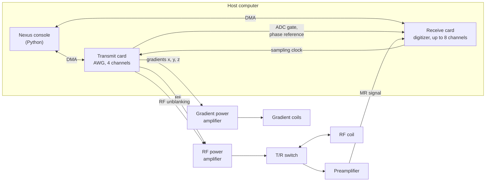
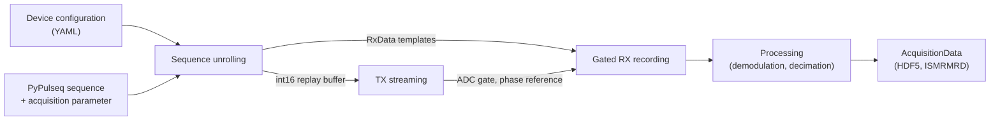

# System overview

Nexus replaces the proprietary spectrometer of an MRI system by two commercial PCIe measurement cards and an open-source Python control software [[1]](../references.md#ref-1). Pulse sequences are defined in the open Pulseq format [[2]](../references.md#ref-2) using PyPulseq [[3]](../references.md#ref-3), converted directly into sampled waveforms on the host computer and streamed to the transmit card. Receive data are recorded in a gated mode, processed on the host and exported in the ISMRMRD format [[4]](../references.md#ref-4).

## System architecture

The two cards share a common sampling clock and are synchronised exclusively through digital signals that are generated as part of the transmit waveform. No further timing hardware is required. Details are given in [Wiring](wiring.md).

## Software architecture

| Layer | Component | Responsibility |
|---|---|---|
| Interface | [`AcquisitionControlManager`][console.service.acquisition_manager.AcquisitionControlManager], `nexus` CLI | Optional client/server access to one acquisition control instance |
| Orchestration | [`AcquisitionControl`][console.spcm_control.acquisition_control.AcquisitionControl] | Loads the configuration, owns the cards and the sequence provider, runs acquisitions |
| Sequence | [`SequenceProvider`][console.pulseq_interpreter.sequence_provider.SequenceProvider] | Unrolls a PyPulseq sequence into the transmit card replay buffer |
| Hardware | [`TxCard`][console.spcm_control.tx_device.TxCard], [`RxCard`][console.spcm_control.rx_device.RxCard] | Card setup, FIFO streaming (TX) and gated recording (RX) |
| Processing | [`RxProcessor`][console.spcm_control.rx_processor.RxProcessor], [`RxData`][console.interfaces.rx_data.RxData] | Parallel demodulation, phase correction and decimation |
| Data | [`AcquisitionData`][console.interfaces.acquisition_data.AcquisitionData] | Result container, HDF5/JSON storage and ISMRMRD export |
| Configuration | [`NexusConfiguration`][console.interfaces.device_configuration.NexusConfiguration], [`AcquisitionParameter`][console.interfaces.acquisition_parameter.AcquisitionParameter] | Static hardware description and runtime parameters |

## From sequence to data

| Step | Description | Page |
|---|---|---|
| 1 | The device configuration describes cards, amplifiers and system limits | [Device configuration](configuration.md) |
| 2 | The sequence is unrolled into an interleaved int16 buffer containing RF, gradients and digital control signals | [Sequence unrolling](sequence-unrolling.md) |
| 3 | The buffer is streamed to the transmit card; the receive card records one gate per ADC event | [Acquisition](acquisition.md) |
| 4 | Each gate is demodulated, phase-corrected and decimated to the ADC dwell time | [Signal flow](signal-flow.md) |

The physical setup required for these steps is described in [Hardware](hardware.md) and [Wiring](wiring.md); the step-by-step procedure is given in [Hardware setup](../setup/hardware-setup.md).
