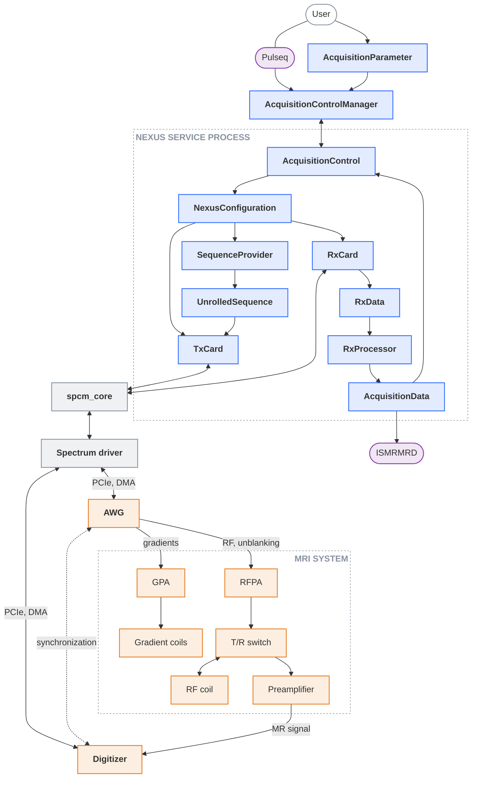

---
hide:
  - toc
---

# System overview

The Nexus console is an open source software framework to operate PCIe measurement cards from Spectrum Instrumentation in a high performance computer system. Pulse sequences are defined in the open Pulseq format [[2]](../references.md#ref-2), converted directly into sampled waveforms on the host computer and streamed to the transmit card. Receive data are recorded in a gated mode, processed on the host and exported in the ISMRMRD format [[4]](../references.md#ref-4). The figure follows the path from the user through the software on the host computer down to the hardware.

  nexus-console
  Spectrum software
  Hardware
  Interface, file format

### Interfaces

The nexus console builds on the following interfaces which can be understood as the input and output of the system.

| Interface | Description | Reference |
|---|---|---|
| Pulseq | Open, vendor-independent sequence format. Sequences are created with (Py-)Pulseq and passed to the console as a PyPulseq `Sequence` object or a `.seq` file. | [Pulseq](https://pulseq.github.io/), [PyPulseq](https://github.com/pulseq/pypulseq), [Examples](../examples/index.md) |
| ISMRMRD | Open data format for raw MRI data which allows to streamline the image reconstruction with external frameworks like MRpro. | [ISMRMRD](https://ismrmrd.readthedocs.io/en/latest/), [MRpro](https://www.mrpro.rocks/) |

### Software

The table gives and overview of the most important software modules implemented within the Nexus console.

| Component | Description | Reference |
|---|---|---|
| `AcquisitionControlManager` | A Python `multiprocessing` manager which provides a service that can be started with the `nexus` command. It serves a single `AcquisitionControl` instance such that clients receive a proxy that behaves like a local `AcquisitionControl`. | [Acquisition service](../setup/nexus-service.md), [Service deployment](../setup/deployment.md) |
| [`AcquisitionControl`][console.spcm_control.acquisition_control.AcquisitionControl] | Loads the device configuration, creates the sequence provider, both cards and the processing pool. It controls the sequence calculation and execution. | [Acquisition](acquisition.md) |
| [`NexusConfiguration`][console.interfaces.device_configuration.NexusConfiguration] | Static description of all the relevant parameters of the setup which are needed to calculate and execute a sequence correctly. | [Device configuration](configuration.md) |
| [`AcquisitionParameter`][console.interfaces.acquisition_parameter.AcquisitionParameter] | Runtime parameters of an acquisition, e.g. Larmor frequency, gradient offsets, etc. | [Acquisition](acquisition.md) |
| [`SequenceProvider`][console.pulseq_interpreter.sequence_provider.SequenceProvider] | Subclass of the PyPulseq `Sequence` that calculates the sequence into the sampled transmit waveforms. | [Sequence calculation](sequence-calculation.md) |
| [`UnrolledSequence`][console.interfaces.unrolled_sequence.UnrolledSequence] | The resulting calculated sequence composed of the RF and gradients waveforms and digital control signals. It also includes the `RxData` templates and the parameters used for the scaling the waveforms. | [Sequence calculation](sequence-calculation.md#replay-buffer) |
| [`TxCard`][console.spcm_control.tx_device.TxCard] | Sets up the AWG module and streams the sequence waveform to the AWG module. | [Acquisition](acquisition.md) |
| [`RxCard`][console.spcm_control.rx_device.RxCard] | Sets up the digitizer and performs the gated recording. | [Acquisition](acquisition.md) |
| [`RxData`][console.interfaces.rx_data.RxData] | Data of one ADC event containing meta information, processing parameters, the raw samples and the processed data. | [Postprocessing](postprocessing.md) |
| [`RxProcessor`][console.spcm_control.rx_processor.RxProcessor] | Pool of worker processes that performs the postprocessing during the acquisition. | [Postprocessing](postprocessing.md), [[5]](../references.md#ref-5) |
| [`AcquisitionData`][console.interfaces.acquisition_data.AcquisitionData] | Result container with the receive data, the sequence, the device configuration and the acquisition parameters. | [Acquisition](acquisition.md), [[4]](../references.md#ref-4) |
| `spcm_core` | Low-level Python bindings of the Spectrum driver, provided by Spectrum Instrumentation as a python package.  | [spcm-core](https://pypi.org/project/spcm-core/) |
| Spectrum driver | Vendor driver library and kernel module to configure the measurement card operations and transfer the data between host memory and the cards. |  [Spectrum Instrumentation download area](https://spectrum-instrumentation.com/support/downloads.php) |

### Hardware

The hardware components mentioned in the diagram above are briefly explained below and summarize a minimal set needed to do MRI. The table lists example components where most of them are open source, which could be used to build a working MRI system.

!!! info "Composition of the Hardware"
    This documentation focusses on the Nexus console. It does not address the composition of an MRI system. For additional information or documentation about how to build the hardware components listed below visit the [OSI² GitLab](https://gitlab.com/osii).

| Component | Description | Example |
|---|---|---|
| AWG | Arbitrary waveform generator. Outputs the RF and gradient waveforms together with the digital control signals for synchronisation and RF unblanking. | [M2p.5933-x4](https://spectrum-instrumentation.com/products/details/M2p5933-x4.php) |
| Digitizer | Records the MR signal in gates triggered by the AWG. | [M2p.6546-x4](https://spectrum-instrumentation.com/products/details/M2p6546-x4.php) |
| Gradient power amplifier (GPA) | Converts the gradient waveforms into coil currents. | [TU Delft GA2](https://gitlab.com/osii/gradient-system/gradient-power-amplifier/tu-delft-ga2) |
| Gradient coils | Generate the gradient fields for spatial encoding. | [32cm Gradient Insert](https://gitlab.com/osii/gradient-system/gradient-coils/32cm-gradient-insert-conventional) |
| RF power amplifier (RFPA) | Amplifies the RF waveform; enabled by the unblanking signal around each RF pulse. | [RFPA-Shoebox](https://barthel-hf.com/doku.php?id=start:prod:spectro#folded_dfb26054d0356f89c15e74dc40304787_4) |
| T/R switch | Routes the RFPA output to the RF coil during transmission and the coil signal to the preamplifier during reception, protecting the receive chain. | [Passive TR Switch](https://gitlab.com/osii/rf-system/tr-switches/eurocard-passive-tr-switch) |
| RF coil | Antenna handling the transmission of RF energy and the reception of the MR signal (usually we use the same coil for transmit and receive). | [RF Head Coil](https://gitlab.com/osii/rf-system/rf-coils/a4im-rf-head-coil) |
| Preamplifier | Low-noise amplification of the MR signal before digitisation. | [Double Channel Preamp](https://gitlab.com/osii/rf-system/pre-amps/double-channel-preamp) |
| Magnet | Generates the static field B0, which determines the Larmor frequency (not shown in the figure). | [30cm Halbach Magnet](https://gitlab.com/osii/magnet/30cm-halbach-magnet) |
