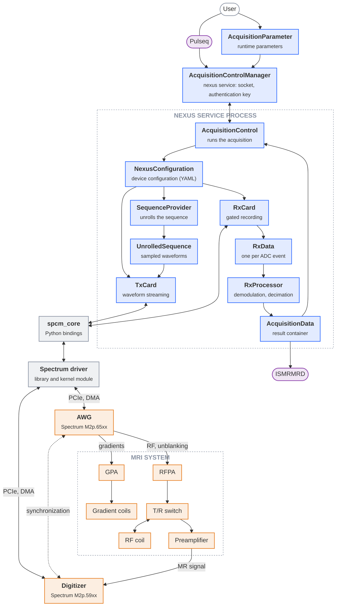

---
hide:
  - toc
---

# System overview

Nexus replaces the proprietary spectrometer of an MRI system by two commercial PCIe measurement cards and an open-source Python control software [[1]](../references.md#ref-1). Pulse sequences are defined in the open Pulseq format [[2]](../references.md#ref-2) using PyPulseq [[3]](../references.md#ref-3), converted directly into sampled waveforms on the host computer and streamed to the transmit card. Receive data are recorded in a gated mode, processed on the host and exported in the ISMRMRD format [[4]](../references.md#ref-4).

## System architecture

The figure follows the path from the user through the software on the host computer down to the hardware. Software and hardware meet at the Spectrum driver, which transfers the waveforms to the transmit card and the receive data from the digitizer by DMA over PCIe.

  nexus-console
  Spectrum software
  Hardware
  Interface, file format
  Data, signal
  Synchronisation

The two cards share a common sampling clock and are synchronised exclusively through digital signals that are generated as part of the transmit waveform. No further timing hardware is required. Details are given in [Wiring](wiring.md).

### Interfaces

| Interface | Description | Reference |
|---|---|---|
| Pulseq | Open, vendor-independent sequence format. Sequences are created with PyPulseq and passed to the console as a PyPulseq `Sequence` object or a `.seq` file. Example sequences are provided in `console.utilities.sequences`. | [[2]](../references.md#ref-2), [[3]](../references.md#ref-3), [Examples](../examples/index.md) |
| ISMRMRD | Open raw data format. `AcquisitionData.save_ismrmrd` exports the acquired data, e.g. for the reconstruction with external frameworks. | [[4]](../references.md#ref-4) |

### Software

| Component | Description | Reference |
|---|---|---|
| User | Defines the sequence and the acquisition parameters in a script or notebook, connects to the acquisition service, calls `set_sequence` and `run` and receives the `AcquisitionData`. Alternatively, `AcquisitionControl` can be instantiated directly in the script without the service. | [First acquisition](../setup/first-acquisition.md), [Remote acquisition](../examples/remote_acquisition.md) |
| [`AcquisitionParameter`][console.interfaces.acquisition_parameter.AcquisitionParameter] | Runtime parameters of an acquisition, e.g. Larmor frequency, gradient offsets, FOV scaling, gradient channel assignment, DDC method and number of averages. Passed together with the sequence. | [Acquisition](acquisition.md) |
| `AcquisitionControlManager` | `nexus_service.acquisition_manager`, a Python `multiprocessing` manager. The service is started with the `nexus` command (`nexus_service.start_manager`), optionally as a systemd unit, and serves a single `AcquisitionControl` instance. It listens on a Unix domain socket (named pipe on Windows) in the runtime directory, which also holds an authentication key generated for each run. Clients receive a proxy that behaves like a local `AcquisitionControl`. | [Acquisition service](../setup/nexus-service.md), [Service deployment](../setup/deployment.md) |
| [`AcquisitionControl`][console.spcm_control.acquisition_control.AcquisitionControl] | Loads the device configuration, creates the sequence provider, both cards and the processing pool. `set_sequence` unrolls the sequence; `run` streams the waveforms, records the receive data for each average and returns the `AcquisitionData`. | [Acquisition](acquisition.md) |
| [`NexusConfiguration`][console.interfaces.device_configuration.NexusConfiguration] | Static description of the setup, loaded from a YAML file: cards, amplifiers, gradient efficiency and system limits. Passed to the `SequenceProvider` for the waveform scaling and to `TxCard` and `RxCard` for the card setup. | [Device configuration](configuration.md) |
| [`SequenceProvider`][console.pulseq_interpreter.sequence_provider.SequenceProvider] | Subclass of the PyPulseq `Sequence`. Unrolls the sequence into the sampled transmit waveforms including the digital control signals (`UnrolledSequence`) and creates one `RxData` template per ADC event. | [Sequence unrolling](sequence-unrolling.md) |
| [`UnrolledSequence`][console.interfaces.unrolled_sequence.UnrolledSequence] | Result of the sequence unrolling: the interleaved int16 replay buffer for the AWG with RF, gradients and digital control signals, the `RxData` templates and the scaling parameters used for the unrolling. | [Sequence unrolling](sequence-unrolling.md#replay-buffer) |
| [`TxCard`][console.spcm_control.tx_device.TxCard] | Sets up the AWG and streams the unrolled sequence to the card during the acquisition. | [Acquisition](acquisition.md) |
| [`RxCard`][console.spcm_control.rx_device.RxCard] | Sets up the digitizer and records one gate per ADC event. Each gate is written to its `RxData` object and passed on for processing. | [Acquisition](acquisition.md) |
| [`RxData`][console.interfaces.rx_data.RxData] | Data of one ADC event: timing and processing parameters from the sequence, the raw samples of the gate and, after processing, the demodulated and decimated signal. | [Signal flow](signal-flow.md) |
| [`RxProcessor`][console.spcm_control.rx_processor.RxProcessor] | Pool of worker processes that demodulates, phase-corrects and decimates the `RxData` objects while the acquisition is still running. | [Signal flow](signal-flow.md), [[5]](../references.md#ref-5) |
| [`AcquisitionData`][console.interfaces.acquisition_data.AcquisitionData] | Result container with the receive data, the sequence, the device configuration and the acquisition parameters. `save` stores it as HDF5 and JSON in a session folder under `~/nexus-console`, `save_ismrmrd` exports the raw data to ISMRMRD. | [Acquisition](acquisition.md), [[4]](../references.md#ref-4) |
| `spcm_core` | Low-level Python bindings of the Spectrum driver, provided by Spectrum Instrumentation as a separate package. Used by `TxCard` and `RxCard` for all card access. | [spcm-core on PyPI](https://pypi.org/project/spcm-core/), [[6]](../references.md#ref-6) |
| Spectrum driver | Vendor driver library and kernel module. Transfers the data between host memory and the cards by DMA over PCIe. | [Hardware](hardware.md#driver), [Hardware setup](../setup/hardware-setup.md#measurement-cards-and-driver), [[6]](../references.md#ref-6) |

### Hardware

| Component | Description | Reference |
|---|---|---|
| AWG (transmit card) | Spectrum M2p.65xx. Outputs the RF and gradient waveforms together with the digital control signals for synchronisation and RF unblanking. | [Hardware](hardware.md), [Wiring](wiring.md), [[6]](../references.md#ref-6) |
| Digitizer (receive card) | Spectrum M2p.59xx. Records the MR signal in gates triggered by the AWG and provides the common sampling clock. | [Hardware](hardware.md), [Wiring](wiring.md), [[6]](../references.md#ref-6) |
| Gradient power amplifier (GPA) | Converts the gradient waveforms into coil currents. Its gain is part of the device configuration. | [Hardware](hardware.md#mri-system) |
| Gradient coils | Generate the gradient fields for spatial encoding. Their efficiency is part of the device configuration. | [Hardware](hardware.md#mri-system) |
| RF power amplifier (RFPA) | Amplifies the RF waveform; enabled by the unblanking signal around each RF pulse. | [Hardware](hardware.md#mri-system) |
| T/R switch | Routes the RFPA output to the RF coil during transmission and the coil signal to the preamplifier during reception, protecting the receive chain. | [Hardware](hardware.md#mri-system) |
| RF coil | Excites the spins and detects the MR signal. | [Hardware](hardware.md#mri-system) |
| Preamplifier | Low-noise amplification of the MR signal before digitisation. | [Hardware](hardware.md#mri-system) |
| Magnet | Generates the static field B0, which determines the Larmor frequency set in the acquisition parameters. Not shown in the figure. | [[1]](../references.md#ref-1) |

The physical setup is described in [Hardware](hardware.md) and [Wiring](wiring.md); the step-by-step procedure is given in [Hardware setup](../setup/hardware-setup.md).
