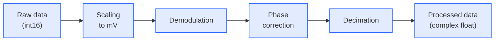

# Postprocessing

Each ADC gate recorded by the digitizer is converted from raw ADC values into a complex baseband signal at the dwell time of the PyPulseq ADC event. The processing runs in parallel to the acquisition: the RX thread submits every gate as an [`RxData`][console.interfaces.rx_data.RxData] object to the [`RxProcessor`][console.spcm_control.rx_processor.RxProcessor], a pool of `num_processing_workers` worker processes that is started once when `AcquisitionControl` is created. The raw samples are passed to the workers via shared memory. With `num_processing_workers: 0`, all gates are processed in the main process after the acquisition. After processing, the raw samples are discarded unless `run(store_unprocessed=True)` is used.

## Processing steps

The steps are implemented in [`RxData.process_data`][console.interfaces.rx_data.RxData.process_data] and applied to each receive channel of a gate:

| Step | Operation |
|---|---|
| Scaling | The int16 values are converted to mV with the input range of the channel: value × `channel_max_amplitude` / 32768. |
| Demodulation | The signal is multiplied by $e^{-j 2\pi f_\text{d} t}$, with the demodulation frequency $f_\text{d}$ = Larmor frequency + frequency offset of the ADC event and the time $t$ from the start of the gate. |
| Phase correction | The phase measured with the phase reference (see below) is removed, and the phase offset of the ADC event is applied, i.e. the signal is multiplied by $e^{j \varphi_\text{ADC}}$. |
| Decimation | The signal is low-pass filtered and down-sampled to the dwell time of the ADC event (see [Decimation filters](#decimation-filters)). The decimation factor is the ratio of the ADC dwell time and the sampling interval of the digitizer. The result is multiplied by 2, which compensates the signal component at $-2 f_\text{d}$ that is removed by the low-pass filter. |

The processed data of a gate contain `num_samples` + 2 × `num_samples_discard` complex samples per receive channel, i.e. the ADC samples plus the samples of the gate extension on both sides (see [ADC events](sequence-calculation.md#adc-events)).

### Phase reference

The gate detection of the digitizer is not phase-locked to the replay of the AWG, so the phase of the demodulated signal would vary from gate to gate. To correct this, the digitizer samples the phase reference, a 1.095 MHz square wave that the AWG outputs at the start of each gate (see [Sequence calculation](sequence-calculation.md#adc-events)). The phase of the reference is determined by demodulating the first ≤ 1000 reference samples at $f_\text{ref}$ = 1.095 MHz and summing them. The phase at $f_\text{ref}$ corresponds to a time offset, which is converted to the phase at the demodulation frequency:

$$
\varphi_\text{ref} = \arg\left( \sum r(t)\, e^{-j 2\pi f_\text{ref} t} \right) \cdot \frac{f_\text{d}}{f_\text{ref}}
$$

The signal of the gate is then multiplied by $e^{-j \varphi_\text{ref}}$.

### Decimation filters

The filter is selected by `AcquisitionParameter.ddc_method` ([`DDCMethod`][console.interfaces.enums.DDCMethod]). The decimation factor must be greater than 1.

| Method | Implementation |
|---|---|
| `FIR` (default) | `scipy.signal.decimate` with an FIR anti-aliasing filter |
| `CIC` | Five-stage cascaded integrator-comb filter [[5]](../references.md#ref-5) that decimates by about half the decimation factor, followed by an FIR decimation by 2 |
| `AVG` | Strided convolution with a windowed kernel that spans 8 decimated samples |

## Data structures

| Object | Content |
|---|---|
| [`RxData`][console.interfaces.rx_data.RxData] | One ADC event of one average: metadata of the event, PyPulseq labels, time stamp of the gate, `processed_data` (complex, shape `(channels, samples)`) and optionally `raw_data` |
| [`AcquisitionData`][console.interfaces.acquisition_data.AcquisitionData] | Result of `AcquisitionControl.run`: flat list of all `RxData`, ordered by average and then by ADC event, the sequence, the acquisition parameters and metadata including the device configuration |

## Storage

All files of an acquisition are written to the folder `<session>/<acquisition id>/`. The session folder is `<home>/nexus-console/<YYYY-MM-DD>-session` by default; the acquisition id consists of date, time and sequence name, e.g. `2026-10-29-143012-se_spectrum`.

| Method | Output |
|---|---|
| `AcquisitionData.save()` | `rx_data.h5`: metadata and one group per `RxData` with its metadata, `processed_data` and, if kept, `raw_data` |
| | `meta.json`: software version, date and time, acquisition id, acquisition parameters, sequence name, duration and definitions, device configuration and additional information from `add_info` |
| | `sequence.seq`: the PyPulseq sequence |
| | `<key>.npy`: additional arrays added with `add_data` |
| `AcquisitionData.save_ismrmrd()` | `data.mrd` in ISMRMRD format [[4]](../references.md#ref-4), see below |

An existing `meta.json` or `sequence.seq` is only overwritten with `save(overwrite=True)`.

## ISMRMRD export

`AcquisitionData.save_ismrmrd(header)` writes the processed data of all ADC events to `data.mrd`, so that they can be reconstructed with external frameworks such as MRpro. It requires processed data.

### Header

The `header` argument provides the encoding information required for the reconstruction, e.g. matrix size, field of view and encoding limits:

| `header` | Used header |
|---|---|
| `ismrmrd.xsd.ismrmrdHeader` | The given header, e.g. created together with the sequence |
| Path to an MRD file | The XML header of that file |
| `None` (default) | An empty header without encoding information |

The following entries of the header are set by the console and overwrite existing values:

| Header entry | Value |
|---|---|
| `measurementInformation` | Acquisition id as measurement id, series date and time |
| `experimentalConditions` | Larmor frequency in Hz |
| `acquisitionSystemInformation` | Number of receive channels, vendor `osi2`, model `Nexus_<version>`, field strength calculated from the Larmor frequency (42.58 MHz/T) |

### Acquisitions

Each `RxData` with processed data becomes one ISMRMRD acquisition, in the order of `AcquisitionData.receive_data`:

| Acquisition field | Value |
|---|---|
| `data` | `processed_data` of the ADC event |
| `scan_counter` | Position in `receive_data` |
| `number_of_samples`, `active_channels` | Samples (including the gate extension) and receive channels of the ADC event |
| `discard_pre`, `discard_post` | `num_samples_discard`, i.e. the samples of the gate extension |
| `center_sample` | `num_samples` / 2, rounded down |
| `sample_time_us` | Dwell time of the ADC event in µs |
| `acquisition_time_stamp` | Start of the gate in µs, relative to the start of the digitizer |
| `idx.average` | Average index |
| `idx` counters and flags | From the PyPulseq labels of the ADC event (see below) |
| `read_dir`, `phase_dir`, `slice_dir` | From the channel assignment (see below) |
| `traj` | k-space trajectory from the sequence (see below) |

The PyPulseq labels set since the previous ADC event are mapped to the counters and flags of the acquisition:

| PyPulseq label | ISMRMRD field |
|---|---|
| `LIN` | `kspace_encode_step_1` |
| `PAR` | `kspace_encode_step_2` |
| `SLC` | `slice` |
| `ECO` | `contrast` |
| `PHS` | `phase` |
| `REP` | `repetition` |
| `SET` | `set` |
| `SEG` | `segment` |
| `NOISE` | Flag `ACQ_IS_NOISE_MEASUREMENT` |
| `REF` | Flag `ACQ_IS_PARALLEL_CALIBRATION` |
| `IMA` | Flag `ACQ_IS_PARALLEL_CALIBRATION_AND_IMAGING` |
| `REV` | Flag `ACQ_IS_REVERSE` |
| `NAV` | Flag `ACQ_IS_NAVIGATION_DATA` |

### Orientation

The directions are given in the patient coordinate system (LPS), assuming a patient in supine, head-first position and the following orientation of the physical gradient channels:

| Physical channel | Patient direction | LPS vector |
|---|---|---|
| 1 | Inferior → superior | (0, 0, 1) |
| 2 | Posterior → anterior | (0, −1, 0) |
| 3 | Right → left | (1, 0, 0) |

`read_dir`, `phase_dir` and `slice_dir` are the vectors of the physical channels assigned to the logical axes x, y and z by `channel_assignment`. They are identical for all acquisitions.

### Trajectory

The k-space trajectory of all ADC samples is calculated from the sequence with PyPulseq (`calculate_kspace`). Only the axes whose values are non-zero for all samples are exported. The acquisitions take consecutive sections of `num_samples` points of the trajectory; for the samples of the gate extension, the first and last trajectory points are repeated.
