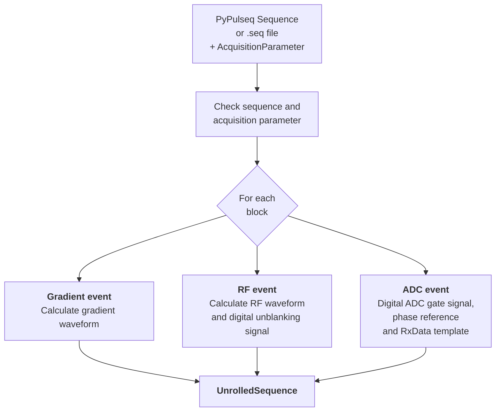
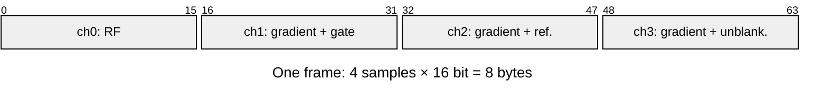
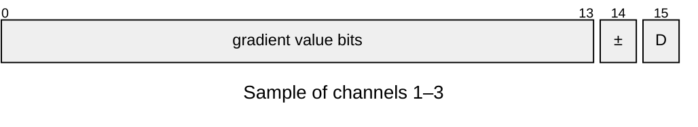
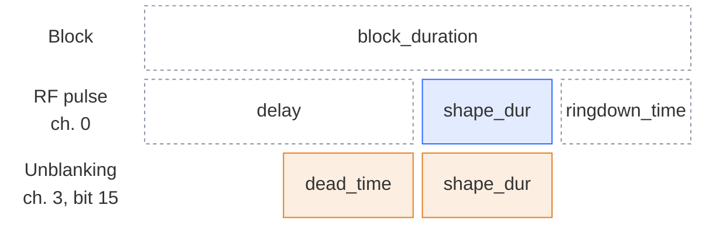
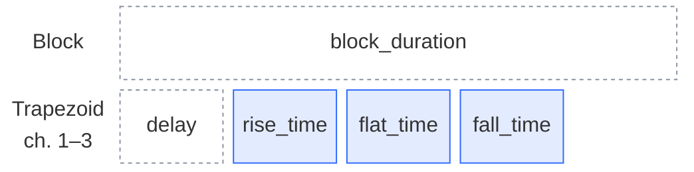
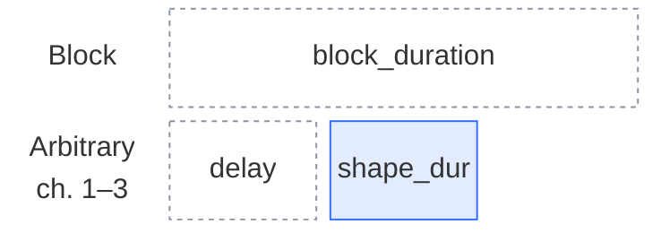
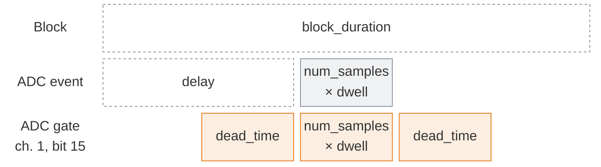

# Sequence calculation

A Pulseq sequence [[2]](../references.md#ref-2) is a list of blocks, each containing at most one RF event, one event per gradient axis, one ADC event and optional labels. The [`SequenceProvider`][console.pulseq_interpreter.sequence_provider.SequenceProvider], a subclass of the PyPulseq `Sequence` [[3]](../references.md#ref-3), calculates the sample-wise replay buffer of the transmit card from this description. The calculation is performed by `AcquisitionControl.set_sequence` before the acquisition starts and returns an [`UnrolledSequence`][console.interfaces.unrolled_sequence.UnrolledSequence].

## Replay buffer

The transmit card outputs one **frame** per sampling interval $\Delta t = 1/f_\text{s}$, e.g. every 50 ns at a sampling rate of $f_\text{s} = 20$ MHz. A frame consists of one 16-bit sample per channel. The replay buffer `UnrolledSequence.seq` is an int16 array that contains all frames of the sequence one after the other, as required by the FIFO mode of the transmit card. Each frame occupies 4 × 16 bit = 8 bytes, so one second of sequence at 20 MHz requires 160 MB.

Channel 0 carries the RF waveform with the full 16-bit resolution (two's complement). Channels 1–3 carry a gradient waveform in bits 0–14 and a digital control signal in bit 15. To free bit 15, each int16 gradient sample is reinterpreted as uint16 and shifted right by one bit: bits 1–15 move to bits 0–14, and only the least significant bit is discarded. Bits 0–14 thus hold a 15-bit two's complement value, with the sign bit in bit 14 and the value bits in bits 0–13. The full scale is unchanged; the resolution is reduced by one bit. The digital signal is then set in bit 15 by a bitwise OR.

| Analog channel | Bit 15 | Digital output | Description |
|---|---|---|---|
| 1 | ADC gate | X1 | Gate is high during an ADC event |
| 2 | Phase reference | X2 | Square wave at a fixed frequency at the start of each ADC gate  |
| 3 | RF unblanking | X3 | Unblanking is high from the RF dead time before each RF pulse until its end |

The transmit card converts bits 0–14 of channels 1–3 to the analog gradient output and routes bit 15 to its digital lines X1–X3 (see [Inputs and outputs](hardware.md#inputs-and-outputs)). Embedding the control signals in the waveform guarantees sample-exact synchronization of RF, gradients, ADC gate and unblanking.

## Block events

Each event of a block is translated into a waveform in two steps: its timing is placed on the frame raster, and its amplitude is scaled to the int16 range of the output channel.

All times of the PyPulseq sequence are converted to whole numbers of frames, i.e. a time $t$ corresponds to $\operatorname{round}(t \cdot f_\text{s})$ frames. Each block starts where the previous block ends, and each event starts at the block start plus its delay. The sum of all block durations must match the total duration of the sequence on the frame raster, otherwise an error is raised. This is the case if all block durations are integer multiples of $\Delta t$, e.g. with `block_duration_raster` = 1 µs at 20 MHz.

### RF events

**Timing.**

The diagram shows the timing of an RF event with the attribute names of the PyPulseq RF event; the widths are not to scale.

- **RF pulse:** starts `delay` after the block start, but not before `dead_time`, and lasts `shape_dur`. It must end within its block.
- **Unblanking:** starts `dead_time` before the RF pulse and ends with it.
- **Ring-down:** `ringdown_time` is not part of the waveform; it is covered by the remaining block duration.

**Amplitude scaling.** The complex PyPulseq envelope $A(t)$ in Hz is resampled to the frame raster (FFT-based), modulated at the Larmor frequency $f_0$ plus the frequency offset $\Delta f$ of the event, and scaled to the int16 range:

$$
s(t) = 32767 \cdot \frac{\alpha_{B_1}\, \kappa_\text{RF}}{U_\text{RF,max}} \cdot \operatorname{Re}\left\{ A(t)\, e^{j\varphi}\, e^{j 2\pi (f_0 + \Delta f)\, t} \right\}
$$

The time $t$ starts at zero at the beginning of each pulse, so the phase of a pulse does not depend on its position in the sequence. The result is truncated to int16. An RF amplitude above the output limit raises an error. If an RF gain lookup table is configured (`rf_gain_lut_path`), it is applied to the int16 samples to linearize the RF power amplifier.

| Symbol | Meaning | Source |
|---|---|---|
| $\alpha_{B_1}$ | B1 scaling | `AcquisitionParameter.b1_scaling` |
| $\kappa_\text{RF}$ | Conversion of the RF amplitude to output voltage (mV/Hz) | `TxConfiguration.rf_to_mvolt` |
| $U_\text{RF,max}$ | RF output limit (mV), doubled for a high-impedance load | `TxConfiguration.channel_max_amplitude` |
| $\varphi$, $\Delta f$ | Phase and frequency offset of the RF event | PyPulseq RF event |
| $f_0$ | Larmor frequency | `AcquisitionParameter.larmor_frequency` |

### Gradient events

**Timing.** A gradient event of the logical axis x, y or z is output on the physical channel given by `channel_assignment`. It starts `delay` after the block start. The diagrams show the attribute names of the PyPulseq gradient events; the widths are not to scale.

- **Trapezoid:** `rise_time`, `flat_time` and `fall_time` are each converted to whole frames; the ramps are linear.

- **Arbitrary waveform:** linearly interpolated to the frame raster over `shape_dur`.

**Amplitude scaling.** The gradient amplitude $G$ in Hz/m is converted to the output voltage $U$ of the channel and scaled to the int16 range:

$$
q = 32767 \cdot \frac{U}{U_\text{max}}, \qquad U = \frac{s_\text{FoV}\, G}{\gamma\, g\, \eta}
$$

$U$ results in V; $U_\text{max}$ is converted to the same unit. The result is truncated to int16 and stored with 15 bits (see [Replay buffer](#replay-buffer)). A gradient amplitude above the output limit raises an error.

| Symbol | Meaning | Source |
|---|---|---|
| $s_\text{FoV}$ | FoV scaling of the logical axis | `AcquisitionParameter.fov_scaling` |
| $\gamma$ | Gyromagnetic ratio (Hz/T) | PyPulseq system (`SystemLimits`) |
| $g$ | GPA gain (A/V) of the physical channel | `TxConfiguration.gpa_gain` |
| $\eta$ | Gradient coil efficiency (T/m/A) of the physical channel | `TxConfiguration.gradient_efficiency` |
| $U_\text{max}$ | Output limit of the physical channel, doubled for a high-impedance load | `TxConfiguration.channel_max_amplitude` |

### ADC events

The diagram shows the attribute names of the PyPulseq ADC event; the widths are not to scale. The ADC samples start `delay` after the block start and last `num_samples` × `dwell`:

- **ADC gate:** extended on both sides by `dead_time`, rounded down to a whole number of dwell times. The receive data of the extension are discarded after processing.
- **Phase reference:** 1.095 MHz square wave during the first 1000 frames of the gate (50 µs at 20 MHz), or the whole gate if it is shorter.

For each ADC event, an [`RxData`][console.interfaces.rx_data.RxData] template is created. It contains the sample counts, dwell times, frequency and phase offsets of the event, and the PyPulseq labels set since the previous ADC event. The templates are filled with data during the acquisition (see [Postprocessing](postprocessing.md)).
