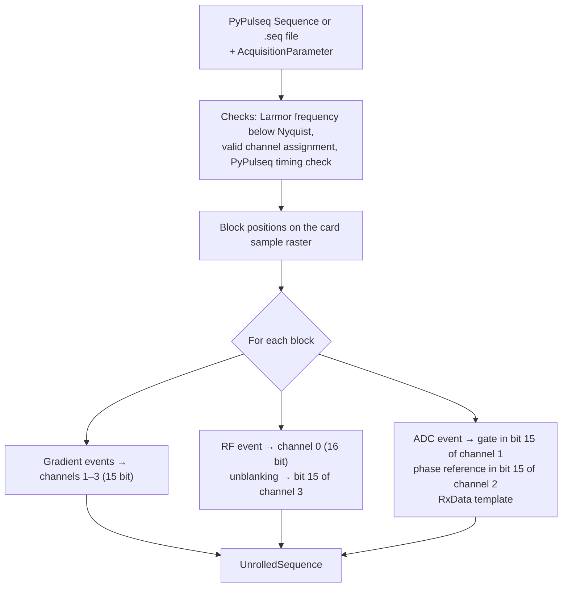
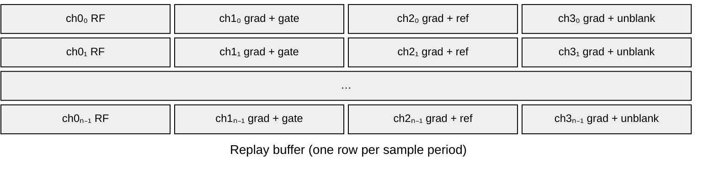
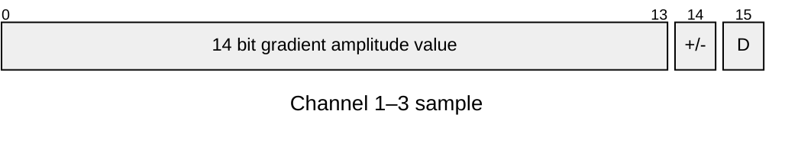

# Sequence unrolling

A Pulseq sequence [[2]](../references.md#ref-2) is a list of blocks, each containing at most one RF event, one event per gradient axis, one ADC event and optional labels. The [`SequenceProvider`][console.pulseq_interpreter.sequence_provider.SequenceProvider], a subclass of the PyPulseq `Sequence` [[3]](../references.md#ref-3), converts this description into the sample-wise replay buffer of the transmit card. This step is called unrolling and is performed by `AcquisitionControl.set_sequence` before the acquisition starts.

## Replay buffer

The output `UnrolledSequence.seq` is a single int16 array of length $4N$ ($N$ = `sample_count`) with the four channels interleaved sample by sample, as required by the FIFO mode of the transmit card. Each sample period $\Delta t$ occupies four consecutive 16-bit words (Fortran order), one per channel:

Channel 0 carries the modulated RF waveform with the full 16-bit resolution (two's complement). The gradient waveforms also carries a digital signal.
Each gradient sample $g$ is first computed as int16. It is then reinterpreted as uint16 and shifted right by one bit: the least significant bit $g_0$ is dropped and the sign bit $g_{15}$ moves to bit 14. Bits 0–14 thus hold the gradient as a 15-bit two's complement value. Bit 15 ($D$) is free and holds the digital control signal, which is combined with the gradient by a bitwise OR:

| Channel | Bit 15 ($D$) | Digital output | High during |
|---|---|---|---|
| 1 | ADC gate | X1 | Gate duration of each ADC event (see [ADC events](#adc-events)) |
| 2 | Phase reference | X2 | 1.095 MHz square wave at the start of each gate (see [ADC events](#adc-events)) |
| 3 | RF unblanking | X3 | From $t_\text{dead}$ before each RF pulse until its end (see [RF events](#rf-events)) |

The transmit card converts bits 0–14 of channels 1–3 to the analog gradient output and routes bit 15 to its digital lines X1–X3 (see [Inputs and outputs](hardware.md#inputs-and-outputs)). Embedding the control signals in the waveform guarantees sample-exact synchronisation of RF, gradients, ADC gate and unblanking.

## Timing

All events are placed on the sample raster of the transmit card with sampling interval $\Delta t = 1/f_\text{s}$ (e.g. 50 ns at $f_\text{s} = 20$ MHz). The block durations are rounded to integer numbers of samples, and the start of each block is the cumulative sum of the preceding block durations. Event delays within a block are rounded in the same way.

## RF events

| Quantity | Definition |
|---|---|
| Start of the RF waveform | $\max(t_\text{dead}, t_\text{delay})$ after block start |
| Unblanking | From $t_\text{dead}$ before the RF waveform until its end (bit 15 of channel 3) |
| Ring-down | Not part of the waveform; covered by the remaining block duration |

The complex PyPulseq envelope $A(t)$ (in Hz) is scaled to the output range, resampled to the card raster (FFT-based) and modulated at the Larmor frequency $f_0$ plus the frequency offset $\Delta f$ of the event:

$$
s_\text{RF}(t) = \operatorname{Re}\left\{ \frac{\alpha_{B_1} \, \kappa_\text{RF}}{U_\text{RF,max}} \, A(t) \, e^{\,j\Delta\varphi} \, e^{\,j 2\pi (f_0 + \Delta f)\, t} \right\} \cdot (2^{15}-1)
$$

with the B1 scaling $\alpha_{B_1}$ (`AcquisitionParameter.b1_scaling`), the conversion factor $\kappa_\text{RF}$ (`rf_to_mvolt`, mV/Hz), the effective RF output limit $U_\text{RF,max}$ (mV), and the phase offset $\Delta\varphi$ of the event. The time $t$ starts at the beginning of each RF pulse. The transmit signal is real-valued, i.e. a single channel carries the modulated pulse. If an RF gain lookup table is configured, it is applied to the int16 samples to linearise the RF power amplifier. An RF amplitude exceeding the output limit raises an error.

## Gradients

Gradient amplitudes $G$ in Hz/m are converted to output voltages using the gradient coil efficiency $\eta$ (T/m/A) and the GPA transconductance $g$ (A/V) of the target channel:

$$
U\,[\text{mV}] = \frac{s_\text{FoV}\, G\,[\text{Hz/m}]}{\gamma\,[\text{Hz/T}] \cdot 10^{-3} \cdot g\,[\text{A/V}] \cdot \eta\,[\text{T/m/A}]}
$$

with the gyromagnetic ratio $\gamma$ of the PyPulseq system and the FoV scaling $s_\text{FoV}$ of the logical axis. The voltage is normalised to the effective output limit of the channel and converted to int16.

| Event type | Sampling on the card raster |
|---|---|
| Trapezoid | Rise, flat top and fall generated by linear ramps with `round(t / Δt)` samples each |
| Arbitrary | Linear interpolation of the PyPulseq waveform |

| Runtime parameter | Effect |
|---|---|
| `channel_assignment` | Maps the logical axes x, y, z to the physical channels 1–3 |
| `fov_scaling` | Scales the waveform of a logical axis |
| `gradient_offset` | Applied as hardware DC offset of the physical channel (see [Acquisition](acquisition.md)); included in the limit check |

## ADC events

For each ADC event with $N$ samples, dwell time $\tau$ and dead time $t_\text{dead}$:

| Quantity | Definition |
|---|---|
| Discard samples | $N_\text{d} = \lfloor t_\text{dead} / \tau \rfloor$ on each side |
| Gate duration | $(N + 2N_\text{d})\,\tau$, i.e. the ADC window extended symmetrically by $N_\text{d}\tau$ |
| Gate (bit 15 of channel 1) | High for the gate duration |
| Phase reference (bit 15 of channel 2) | 1.095 MHz square wave during the first $\min(N_\text{raw}, 1000)$ samples of the gate |

For each ADC event, an [`RxData`][console.interfaces.rx_data.RxData] template is created. It contains the sample counts, dwell times, frequency and phase offsets of the event, and the PyPulseq labels set since the previous ADC event. The templates are filled with data during the acquisition (see [Signal flow](signal-flow.md)).

## Inspection

The unrolled waveforms can be inspected before running an acquisition for a given time interval with `AcquisitionControl.plot_waveforms(time_range)`, which decodes the replay buffer into the RF and gradient waveforms, the ADC gate and the unblanking signal.
