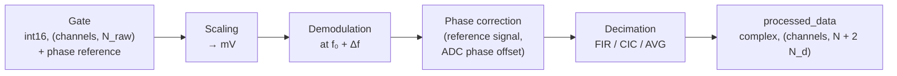

# Postprocessing

Each gate recorded by the receive card is converted from raw ADC values to a complex baseband signal at the dwell time of the PyPulseq ADC event. The processing runs in parallel to the acquisition: the RX thread submits each gate to the [`RxProcessor`][console.spcm_control.rx_processor.RxProcessor], a pool of `num_processing_workers` processes. Raw samples are passed to the workers via shared memory. With `num_processing_workers: 0`, processing is performed in the main process after the acquisition.

## Processing steps

The steps are implemented in [`RxData.process_data`][console.interfaces.rx_data.RxData.process_data]. With the raw sampling interval $\Delta t$ and the sample index $n$ counted from the start of the gate:

| Step | Operation |
|---|---|
| Scaling | $d[n] = d_\text{ADC}[n] \cdot U_\text{max} / 2^{15}$, with the input range $U_\text{max}$ (mV) of the channel |
| Demodulation | $d_\text{bb}[n] = d[n] \, e^{-j 2\pi f_\text{d} n \Delta t}$, with $f_\text{d} = f_0 + \Delta f$ (Larmor frequency plus ADC frequency offset) |
| Phase correction | $d_\text{bb} \leftarrow d_\text{bb} \, e^{-j\phi_\text{ref}} \, e^{\,j\Delta\varphi}$, with the reference phase $\phi_\text{ref}$ (below) and the ADC phase offset $\Delta\varphi$ |
| Decimation | Low-pass filtering and down-sampling by $R = \operatorname{round}(\tau / \Delta t)$ to the ADC dwell time $\tau$; the result is multiplied by 2 to compensate for the removed component at $-2f_\text{d}$ |

### Phase reference

To make the phase of the demodulated signal independent of the timing between transmit waveform and gate detection, the receive card samples a reference signal that is generated by the transmit card synchronously with each gate. The reference $r[n]$ is a square wave at $f_\text{ref} = 1.095$ MHz during the first samples of every gate. Its phase is determined for each gate as:

$$
\phi_\text{ref} = \arg\left( \sum_n r[n] \, e^{-j 2\pi f_\text{ref} n \Delta t} \right) \cdot \frac{f_\text{d}}{f_\text{ref}}
$$

The phase measured at $f_\text{ref}$ corresponds to a time offset between transmit and receive time base, which is converted into the corresponding phase at the demodulation frequency $f_\text{d}$.

### Decimation filters

The method is selected by `AcquisitionParameter.ddc_method` ([`DDCMethod`][console.interfaces.enums.DDCMethod]):

| Method | Implementation |
|---|---|
| `FIR` (default) | `scipy.signal.decimate` with FIR anti-aliasing filter |
| `CIC` | Five-stage cascaded integrator-comb filter [[5]](../references.md#ref-5) decimating by $R/2$, followed by FIR decimation by 2 |
| `AVG` | Strided convolution with a windowed kernel over 8 output samples |

## Data structures

| Object | Content |
|---|---|
| [`RxData`][console.interfaces.rx_data.RxData] | One ADC event of one average: metadata, labels, `processed_data` (complex, shape `(channels, N + 2 N_d)`), optionally `raw_data` |
| [`AcquisitionData`][console.interfaces.acquisition_data.AcquisitionData] | Flat list of all `RxData` (ordered by average and ADC index), the sequence, the acquisition parameters and meta data including the device configuration |

The processed data contain $N_\text{d}$ additional samples on each side of the ADC window (ADC dead time, see [Sequence calculation](sequence-calculation.md#adc-events)). They are kept in the data and flagged as `discard_pre`/`discard_post` in the ISMRMRD export.

## Storage

| Method | Output (in `<session>/<acquisition id>/`) |
|---|---|
| `AcquisitionData.save()` | `rx_data.h5` (receive data with metadata), `meta.json`, `sequence.seq`, additional arrays added with `add_data` as `.npy` |
| `AcquisitionData.save_ismrmrd()` | `data.mrd` in ISMRMRD format [[4]](../references.md#ref-4) |

The session directory is `<home>/nexus-console/<YYYY-MM-DD>-session` by default; the acquisition id consists of date, time and sequence name.

In the ISMRMRD export, the PyPulseq labels of each ADC event are mapped to the acquisition header:

| PyPulseq label | ISMRMRD field |
|---|---|
| `LIN` | `kspace_encode_step_1` |
| `PAR` | `kspace_encode_step_2` |
| `SLC` | `slice` |
| `ECO` | `contrast` |
| `PHS` | `phase` |
| `REP` | `repetition` |
| `SET` | `set` |
| `SEG` | `segment` |
| `NOISE`, `REF`, `IMA`, `REV`, `NAV` | Acquisition flags |

The average index is stored in the `average` counter. The k-space trajectory is calculated from the sequence, and the readout, phase and slice directions are derived from `channel_assignment`.
