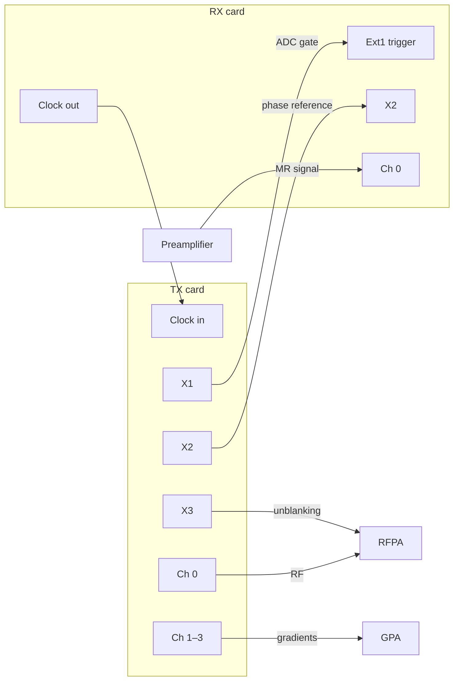

# Wiring

The transmit (TX) and receive (RX) cards are synchronised by a shared sampling clock and by two digital signals that are generated by the TX card together with the waveforms. No additional trigger or timing hardware is required. All assignments on this page are fixed in the card setup code ([`TxCard.setup_card`][console.spcm_control.tx_device.TxCard.setup_card], [`RxCard.setup_card`][console.spcm_control.rx_device.RxCard.setup_card]).

## Connections

### Between the cards

| Signal | Source | Destination | Card configuration |
|---|---|---|---|
| Sampling clock | RX clock output | TX clock input | RX: internal PLL, clock output enabled. TX: external clock, 50 Ω termination, 1.5 V threshold |
| ADC gate | TX X1 | RX external trigger input (Ext1) | TX: X1 = bit 15 of channel 1. RX: gated FIFO mode on positive edge of Ext1 |
| Phase reference | TX X2 | RX X2 | TX: X2 = bit 15 of channel 2. RX: X2 as digital input, sampled into bit 15 of channel 0 |

The RX card is the clock master. Consequently, the sampling rates of both cards in the device configuration must be identical.

### To the MRI system

| Signal | Source | Destination | Content |
|---|---|---|---|
| RF | TX channel 0 | RFPA input | RF pulse modulated at the Larmor frequency, 16 bit |
| Gradient 1 | TX channel 1 | GPA input | Gradient waveform, 15 bit |
| Gradient 2 | TX channel 2 | GPA input | Gradient waveform, 15 bit |
| Gradient 3 | TX channel 3 | GPA input | Gradient waveform, 15 bit |
| RF unblanking | TX X3 | RFPA unblanking input | High from `rf_dead_time` before an RF pulse until its end |
| MR signal | Preamplifier output | RX channel 0 | Received signal at the Larmor frequency |
| Further inputs | Optional | RX channels 1–7 | E.g. additional receive coils |

The assignment of the logical gradient axes x, y and z to the physical channels 1–3 is defined at runtime by `AcquisitionParameter.channel_assignment` (default: x → 1, y → 2, z → 3). The digital signals always remain on the physical channels given above.

## Port assignment per card

### TX card (M2p.65xx)

| Port | Direction | Assignment |
|---|---|---|
| Channel 0 | Analog out | RF |
| Channel 1 | Analog out | Gradient (physical channel 1) |
| Channel 2 | Analog out | Gradient (physical channel 2) |
| Channel 3 | Analog out | Gradient (physical channel 3) |
| Clock in | In | Sampling clock from RX card |
| X0 | – | Not used |
| X1 | Digital out | ADC gate (bit 15 of channel 1) |
| X2 | Digital out | Phase reference, 1.095 MHz square wave (bit 15 of channel 2) |
| X3 | Digital out | RF unblanking (bit 15 of channel 3) |
| X12 | Digital out | Copy of the ADC gate; only with IO expansion module (`DIG16_FX2`/`DIG16_SMB`) |
| X13 | Digital out | Copy of RF unblanking; only with IO expansion module |

### RX card (M2p.59xx)

| Port | Direction | Assignment |
|---|---|---|
| Channel 0 | Analog in | MR signal; bit 15 carries the sampled X2 input |
| Channels 1–7 | Analog in | Optional; enabled via `channel_enable` |
| Clock out | Out | Sampling clock to TX card |
| Ext1 (trigger) | In | ADC gate from TX X1 |
| X2 | Digital in | Phase reference from TX X2 |

The exact connector labels and electrical levels are specified in the hardware manuals of the cards [[6]](../references.md#ref-6).

## Termination

The output voltage of the TX card doubles if an output is terminated into high impedance instead of 50 Ω. The termination of the RF and gradient outputs is therefore part of the device configuration (`rf_terminated_50ohm`, `gradients_terminated_50ohm`). For unterminated outputs, the effective output limits and the hardware gradient offsets are scaled accordingly. The RX input impedance is set per channel (`channel_terminated_50ohm`).

## Safety

The multi-purpose lines are pulled high while the cards are opened ([issue #54](https://github.com/schote/nexus-console/issues/54)). As X3 drives the RFPA unblanking input, the RF and gradient power amplifiers must be switched off when the console software connects to the cards.
